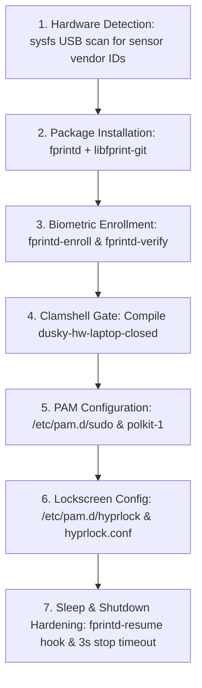

# Master Architectural Audit & Exhaustive Borrowing Blueprint: Dusky vs. Omarchy

> **Primary Destination**: [`info.md`](file:///home/dusk/.config/todo/info.md)  
> **Mirror Destination**: [`omarchy_audit_info.md`](file:///home/dusk/Documents/omarchy_audit_info.md)  
> **Audited Repositories**:
> - **Dusky** (User): [`/mnt/zram1/dusky-future`](file:///mnt/zram1/dusky-future)
> - **Omarchy Quattro** (DHH / 37signals): [`/mnt/zram1/omarchy-quattro`](file:///mnt/zram1/omarchy-quattro)  
> **Target Platform Baseline**: Linux Kernel 7.3+, Hyprland-git (Wayland only, no XWayland), systemd 262, fzf 0.74.4, Python 3.15, GNU Bash 5.3.

---

## 1. Deep Dive: Dusky's Existing Discovery Mechanisms & How to Upgrade Them

### A. Ground Truth: What Dusky Already Has
Dusky already possesses a sophisticated, multi-tiered interactive discovery system embedded in ZSH:

1. **Interactive Scripts Finder** ([`scripts`](file:///mnt/zram1/dusky-future/.config/zshrc/scripts) aliased to `s`):
   - Invokes [`scripts_finder.py`](file:///mnt/zram1/dusky-future/user_scripts/tools/find_scripts/scripts_finder.py) (26 KB Python application).
   - Dynamically walks `~/user_scripts/` for `.sh` and `.py` files.
   - Computes **frecency usage weights** (`~/.config/dusky/settings/scripts_fzf/state.json`) and decorates frequent scripts with star icons (`★ 12`).
   - Uses `fzf` with full syntax-highlighted previews via `bat`, file metadata (`Alt-I`), and source inspection (`Alt-S`).
   - Offers an interactive action menu on `Enter`: Run & copy path (`Alt-R`), put into prompt buffer via `print -z` (`Alt-T`), edit in Neovim (`Alt-E`), or reveal in Yazi (`Alt-Y`).
2. **Interactive Command Atlas** ([`cmd_atlas`](file:///mnt/zram1/dusky-future/.config/zshrc/cmd_atlas) aliased to `atlas`):
   - Inspects active ZSH aliases, global aliases, suffix aliases, and functions.
   - Formats a categorized, colored `fzf` table with full documentation strings from the `ZSH_DOCS` associative array.
   - Places the selected command directly into the ZSH editing buffer ready for execution.
3. **Dedicated Domain Routers** in [`~/.config/zshrc/`](file:///mnt/zram1/dusky-future/.config/zshrc/):
   - [`core`](file:///mnt/zram1/dusky-future/.config/zshrc/core): CPU affinity runner with flag routing (`core [flags...] <command>`).
   - [`pkg`](file:///mnt/zram1/dusky-future/.config/zshrc/pkg) & [`pkg_search`](file:///mnt/zram1/dusky-future/.config/zshrc/pkg_search): Advanced pacman/expac package querying.
   - [`git_dusky`](file:///mnt/zram1/dusky-future/.config/zshrc/git): Bare git repo controller and diff engine.
   - [`win10`](file:///mnt/zram1/dusky-future/.config/zshrc/win10) & [`vfio`](file:///mnt/zram1/dusky-future/.config/zshrc/vfio): Windows KVM and GPU passthrough bindings.

---

### B. What Omarchy Does Differently & Better in Command Discovery
While Dusky's `scripts` and `atlas` are interactive TUI pickers, Omarchy uses a **dual-layer model**:

```
┌─────────────────────────────────────────────────────────────────────────────┐
│                       DISCOVERY MODEL COMPARISON                            │
├──────────────────────────────────────┬──────────────────────────────────────┤
│                DUSKY                 │               OMARCHY                │
├──────────────────────────────────────┼──────────────────────────────────────┤
│ • Interactive-only (fzf TUI)         │ • Both interactive AND direct CLI   │
│ • Paths indexed, but no docstrings   │ • Standardized # omarchy: headers    │
│ • cmd_atlas disconnected from scripts │ • One unified command namespace      │
│ • Manual ZSH_DOCS dictionary entries │ • Auto-generated help & --json docs  │
│ • No zsh completion for user_scripts │ • Full tab-completion across commands│
└──────────────────────────────────────┴──────────────────────────────────────┘
```

1. **Header Metadata vs. Hardcoded Dictionaries**:
   - In Dusky, `cmd_atlas` requires manually editing the `ZSH_DOCS` array inside `~/.config/zshrc/cmd_atlas`. Standalone scripts in `user_scripts/` do not feed into this atlas.
   - In Omarchy, every script in [`bin/`](file:///mnt/zram1/omarchy-quattro/bin) declares its own metadata at the top of the file:
     ```bash
     # omarchy:summary=Set and show lightweight desktop notification reminders
     # omarchy:args=[-i|--interactive] | <minutes> [message]
     # omarchy:examples=omarchy reminder 5 "Check oven"
     ```
   - The CLI parser dynamically reads these lines, eliminating central registration drift.
2. **Non-Interactive Programmatic Dispatch**:
   - Dusky's `s` / `scripts` requires interactive keyboard navigation. If a keybinding, another script, or an AI agent wants to run a script, it cannot use `s`; it must call the raw file path `/home/dusk/user_scripts/battery/limiter/battery_limit_cli.py 80`.
   - Omarchy allows both: `omarchy menu` opens interactive menus, while `omarchy battery status` runs directly.

---

### C. Concrete Blueprint to Upgrade Dusky's Discovery System

1. **Standardize Self-Documenting Script Headers**:
   Add a uniform header to scripts in `user_scripts/`:
   ```bash
   # dusky:summary=Cap hardware battery charging at 80% to preserve longevity
   # dusky:args=[--status | --set <percentage>]
   # dusky:examples=dusky battery limiter --set 80
   ```
2. **Upgrade `scripts_finder.py` to Show Descriptions in FZF**:
   Modify `discover()` in [`scripts_finder.py`](file:///mnt/zram1/dusky-future/user_scripts/tools/find_scripts/scripts_finder.py#L90) to parse the `# dusky:summary=` line (or the Python docstring) and display it in fzf as a secondary column:
   ```
   battery/limiter/battery_limiter.sh   │ Cap battery charge at 80% to preserve life
   audio/radio/dusky_radio_menu.sh      │ Stream online radio stations via mpv
   ```
   This allows users to search `fzf` by **what the script does**, not just its filename!
3. **Build a Top-Level `dusky` CLI Dispatcher**:
   Deploy a central router `/usr/bin/dusky` or `~/.local/bin/dusky`:
   - `dusky` (no args) -> launches `scripts` (interactive fzf picker).
   - `dusky atlas` -> launches `cmd_atlas`.
   - `dusky <category> <script> [args...]` -> directly dispatches to `user_scripts/<category>/<script>` without launching fzf.
   - `dusky <category> <script> --help` -> parses and prints the `# dusky:args` and `# dusky:examples`.
4. **ZSH Dynamic Tab Completion**:
   Add a `_dusky` completion function to `.config/zshrc/` completing categories and scripts on `<TAB>`.

---

## 2. Complete Blueprint: Setting Up Fingerprint Authentication in Dusky

Omarchy includes an enterprise-grade biometric setup that handles hardware discovery, PAM integration, clamshell lid detection, sleep wakeups, and lockscreen integration. Dusky currently only has commented-out lines in Hyprlock.

Here is the complete, bite-by-bite guide to implementing fingerprint authentication in Dusky:



---

### Step 1: Automated Hardware Detection (Before Packages are Installed)
Do not assume `fprintd` is present. Detect biometric hardware directly via Linux sysfs:
- **Reference Script**: [`bin/omarchy-hw-fingerprint`](file:///mnt/zram1/omarchy-quattro/bin/omarchy-hw-fingerprint)
- **Mechanism**: Inspect `/sys/bus/usb/devices/*/idVendor` and `product`. Check against known biometric USB vendor IDs:
  - `27c6` (Goodix)
  - `138a` / `06cb` (Validity / Synaptics)
  - `08ff` (AuthenTec)
  - `1c7a` (LighTuning)
  - `147e` (UPEK)
  - String regex: `*fingerprint*`, `*biometric*`, `*elan:arm-m4*`, `*fpc*`.
- **Implementation for Dusky**: Create `/usr/local/bin/dusky-hw-fingerprint`.

---

### Step 2: Package Requirements
Install the PAM biometric daemon and driver library:
```bash
sudo pacman -S --needed --noconfirm fprintd libfprint
# Or libfprint-git from AUR if targeting newer laptop sensors
```

---

### Step 3: Fingerprint Enrollment & Verification
- **Enrollment**:
  ```bash
  sudo fprintd-enroll "$USER"
  ```
  Prompts the user to swipe/press their finger repeatedly until enrolled.
- **Verification**:
  ```bash
  fprintd-verify
  ```
  Verifies that the fingerprint matches before touching any authentication configurations.

---

### Step 4: The Clamshell Gate (The Critical Problem Solved)
> [!IMPORTANT]
> **The Problem**: When a laptop is in **clamshell mode** (lid closed, connected to an external monitor and keyboard on a desk), the laptop palmrest fingerprint sensor is physically inaccessible. If PAM unconditionally asks for a fingerprint, every `sudo` or `polkit` prompt will hang for 30 seconds waiting for a fingerprint timeout before showing the password prompt!

- **Omarchy's Solution**: A lightweight lid detector [`bin/omarchy-hw-laptop-closed`](file:///mnt/zram1/omarchy-quattro/bin/omarchy-hw-laptop-closed).
  - Checks `/proc/acpi/button/lid/*/state` (reports `closed`).
  - Checks `/sys/class/input/*/capabilities/sw` for `SW_LID` bit.
  - Falls back to D-Bus query: `org.freedesktop.login1.Manager.LidClosed`.
  - Exits with `0` if closed, `1` if open.
- **Implementation for Dusky**: Create `/usr/local/bin/dusky-hw-laptop-closed`.

---

### Step 5: PAM Configuration (`sudo`, `polkit-1`, and `hyprlock`)
In PAM syntax, `[success=1 default=ignore]` means: *If the gate succeeds (laptop lid is closed), skip the next 1 rule (`pam_fprintd.so`) and fall straight through to password authentication!*

1. **`/etc/pam.d/sudo`**:
   Insert at line 1:
   ```pam
   auth      [success=1 default=ignore] pam_exec.so quiet /usr/local/bin/dusky-hw-laptop-closed
   auth      sufficient pam_fprintd.so
   ```
2. **`/etc/pam.d/polkit-1`**:
   ```pam
   auth      [success=1 default=ignore] pam_exec.so quiet /usr/local/bin/dusky-hw-laptop-closed
   auth      sufficient pam_fprintd.so
   auth      include    system-auth
   account   include    system-auth
   password  include    system-auth
   session   include    system-auth
   ```
3. **`/etc/pam.d/hyprlock`**:
   ```pam
   auth      sufficient pam_fprintd.so
   auth      include    system-auth
   account   include    system-auth
   password  include    system-auth
   session   include    system-auth
   ```

---

### Step 6: Hyprlock Configuration in Dusky
In Dusky's Hyprlock themes (`.config/hypr/hyprlock_themes/*/hyprlock.conf`):
Uncomment and configure the fingerprint block:
```ini
fingerprint {
    enabled = true
    ready_message = Scan fingerprint to unlock
    present_message = Scanning fingerprint...
    retry_message = Please try again
    fail_message = Fingerprint verification failed
}
```

---

### Step 7: Systemd Sleep & Shutdown Hardening
Biometric USB devices frequently misbehave during sleep and shutdown:
1. **Sleep Resume Wedge Fix**:
   Create `/usr/lib/systemd/system-sleep/fprintd-resume` (Reference: [`default/systemd/system-sleep/fprintd-resume`](file:///mnt/zram1/omarchy-quattro/default/systemd/system-sleep/fprintd-resume)):
   ```bash
   #!/bin/bash
   # Suspend can wedge fprintd's USB device claim; restart it after resume
   if [[ $1 == "post" ]]; then
     systemctl --no-block try-restart fprintd.service 2>/dev/null || true
   fi
   ```
   Set executable: `sudo chmod +x /usr/lib/systemd/system-sleep/fprintd-resume`.
2. **Shutdown Timeout Safeguard**:
   Create `/etc/systemd/system/fprintd.service.d/10-stop-timeout.conf` (Reference: [`default/systemd/system/fprintd.service.d/10-stop-timeout.conf`](file:///mnt/zram1/omarchy-quattro/default/systemd/system/fprintd.service.d/10-stop-timeout.conf)):
   ```ini
   [Service]
   TimeoutStopSec=3s
   ```
   Prevents an unresponsive fprintd daemon from stalling system shutdowns for 90 seconds.

---

### Step 8: First-Run Automatic Invitation Hook
Create a post-install hook in Dusky's setup pipeline (Reference: [`setup-fingerprint.hook`](file:///mnt/zram1/omarchy-quattro/install/user/first-run/setup-fingerprint.hook)):
- Checks if `dusky-hw-fingerprint` detects a sensor.
- Checks if `/var/lib/fprint/$USER` is empty.
- Sends a critical notification: *"Setup Fingerprint Reader: Click to enable sudo and lockscreen unlocking with your fingerprint."*
- Clicking launches the enrollment wizard in a terminal window.

---

## 3. Comprehensive Side-by-Side Domain Matrix (26 Domains)

| Domain | Dusky (`dusky-future`) | Omarchy (`omarchy-quattro`) | What Dusky Should Borrow |
| :--- | :--- | :--- | :--- |
| **1. CLI & Discovery** | Interactive `scripts` (fzf) + `cmd_atlas`. | Dynamic `# omarchy:` header parsing with CLI router. | Standardize `# dusky:` headers; show descriptions in fzf; create `dusky` CLI. |
| **2. Update Engine** | Git supervisor with divergence checks & backups. | Epoch bash migrations in [`migrations/`](file:///mnt/zram1/omarchy-quattro/migrations). | Add `dusky_migrate.sh` to execute incremental update migrations. |
| **3. Pacman Safety** | Standard scripts. | ALPM hooks pausing Hyprland reload and upgrade guard. | Add ALPM reload-pause hooks to prevent compositor reload storms. |
| **4. Fingerprint Auth** | Commented config in Hyprlock. | Full fprintd enrollment, clamshell gate, sleep resume hook. | Implement the complete 8-step fingerprint architecture detailed in Section 2. |
| **5. Desktop UI Shell** | Modular Waybar (20 styles) + Rofi + Mako. | Monolithic Quickshell (`shell.qml`). | **Keep Waybar modularity**, borrow dropdown card layouts for quick actions. |
| **6. Theming Model** | Dynamic Matugen wallpaper palette (56 templates). | 23 designer palettes with `.tpl` templates + RGB keyboard. | **Keep Matugen**, borrow hardware RGB keyboard sync and preset themes. |
| **7. Keyboard Ergonomics**| Standard Linux split (`Ctrl+Shift+C` vs `Ctrl+C`). | Universal `Super+C/V/X/A` auto-detecting terminal window tag. | Borrow window-tag shortcut translator with 50ms keyup timer. |
| **8. Crash Diagnostics** | Manual journalctl investigation. | Real-time `systemd-coredump` journal watcher + AI diagnosis. | Borrow `dusky_crash_watch.sh` connecting core dumps to AI analysis. |
| **9. Privileged Ops** | Standard sudo password prompts. | Time-bounded passwordless sudo (15m, 1h, 1d) via tmpfiles. | Borrow `dusky_sudo_timed.sh` for autonomous AI agent sessions. |
| **10. Screen Recording** | Basic GPU recorder scripts. | Webcam PiP overlay with dynamic resize, -14 LUFS normalization. | Borrow audio normalization filter chain and webcam picture-in-picture. |
| **11. Screen OCR & QR** | Standard grim/slurp/swappy. | Freeze frame (`hyprpicker -r -z`), Tesseract OCR, secret-safe QR. | Borrow freeze-frame region selection and `wl-copy --sensitive`. |
| **12. Speaker Acoustics** | Raw PipeWire routing scripts. | Isolated PipeWire client running LV2 DSP limiter/EQ by DMI SKU. | Borrow PipeWire DSP speaker calibration for Dell XPS, MacBooks, etc. |
| **13. Display Brightness** | Laptop panel brightness only. | Laptop panel + external monitor DDC/CI hardware brightness via I2C. | Borrow DDC/CI brightness control for external desktop monitors. |
| **14. Voice Dictation** | Raw model downloads in `user_scripts/tts_stt/`.| Push-to-talk (`Right Alt`) typing directly into Wayland inputs. | Borrow push-to-talk system-wide input injection daemon. |
| **15. Web Apps / PWAs** | Manual site shortcuts in `.config/dusky_sites/`.| Automated generator with icon extraction and `StartupWMClass`. | Borrow `dusky_webapp_install.py` for one-command PWA creation. |
| **16. Network & Wi-Fi** | Tailscale, WireGuard, SSHFS, WARP. | Generates standard `WIFI:S:...;P:...;;` QR code from NetworkManager.| Borrow Wi-Fi QR generator for instant mobile device connection. |
| **17. Hibernation** | Manual swap and kernel parameters. | Btrfs swapfile hibernation with s2idle RTC alarm in Limine. | Borrow automated Btrfs hibernation setup with RTC alarm wakeups. |
| **18. Sleep & Wakeup** | TLP, Powertop, battery notify. | Sleep hooks: FUSE lazy-unmount and hybrid GPU Vfio unbind. | Borrow FUSE lazy-unmount and hybrid GPU hibernation hooks. |
| **19. Clamshell Mode** | Basic clamshell script. | Remembers internal panel scale, disables eDP, auto-recovers. | Borrow internal display scale memory and recovery unit. |
| **20. Windows VM** | Bare-metal VFIO GPU passthrough for gaming. | Containerized KVM Windows 11 VM with HiDPI RDP & OEM key tool. | **Keep VFIO**, borrow Docker Windows VM for casual Office use + OEM key tool. |
| **21. File Manager** | Standard GUI file managers. | Nautilus Python extensions for LocalSend and transcoding. | Borrow Nautilus right-click Python context actions. |
| **22. Video Downloader** | Manual terminal yt-dlp. | Browser extension + native messaging host streaming to OSD. | Borrow native messaging host streaming download progress to desktop OSD. |
| **23. Disk Benchmark** | Sysbench and RAM test scripts. | Real-time direct I/O test with Btrfs NOCOW and hardware block stats. | Borrow Btrfs NOCOW direct I/O disk speedtest. |
| **24. PDF Form Filling** | Zathura document viewer. | Bundled `Signed` tool for freeform text, dates, and signatures. | Add `signed` to Dusky's application manifest. |
| **25. System Reset** | Snapper snapshot revert. | `@factory` snapshot reset returning machine to clean first-run OEM. | Borrow factory snapshot restore paradigm for pre-install distribution. |
| **26. Automated QA** | Selective module unit tests. | Root-level TAP test harness validating all CLI scripts. | Borrow root-level TAP automated test suite for script validation. |

---

## 4. Bite-by-Bite Technical Deep Dives: 20 Features to Borrow

### 1. Unified CLI Command Router with Metadata Self-Documentation
- **The Problem**: Dusky contains 1,265 user scripts in deep nested paths. While `scripts` (fzf) provides interactive exploration, there is no direct command-line invocation syntax or self-documenting help system.
- **How Omarchy Does It**:
  - The [`omarchy`](file:///mnt/zram1/omarchy-quattro/bin/omarchy) script acts as a dynamic dispatcher.
  - Scripts declare metadata in their first 80 lines using comments:
    ```bash
    # omarchy:summary=Set and show lightweight desktop notification reminders
    # omarchy:args=[-i|--interactive] | <minutes> [message]
    # omarchy:examples=omarchy reminder 5 "Check oven"
    ```
  - Subcommands are mapped dynamically: `omarchy battery low` invokes `omarchy-battery-low`.
  - Generates fuzzy suggestions on typos and exports complete CLI schemas via `--json`.
- **Why Omarchy Is Better**: Provides a clean, professional command surface while keeping scripts decoupled.
- **Omarchy Reference File**: [`bin/omarchy`](file:///mnt/zram1/omarchy-quattro/bin/omarchy)
- **Target in Dusky**: Create `/usr/local/bin/dusky` and annotate scripts in `user_scripts/`.

---

### 2. Idempotent Timestamped Migrations for Dotfiles Updates
- **The Problem**: When updating dotfiles over Git, configuration syntax updates, new package requirements, directory moves, or systemd unit changes often break an existing user's setup.
- **How Omarchy Does It**:
  - Each change is encapsulated in an epoch-timestamped script in [`migrations/<epoch>.sh`](file:///mnt/zram1/omarchy-quattro/migrations).
  - The runner [`omarchy-migrate`](file:///mnt/zram1/omarchy-quattro/bin/omarchy-migrate) iterates over all migration scripts.
  - If a corresponding marker does not exist in `~/.local/state/omarchy/migrations/<epoch>.sh`, the script runs and the marker is touched upon success.
  - Automatically waits for any active `pacman` transaction locks before executing.
- **Why Omarchy Is Better**: Unlike raw git pull/reset logic, migrations guarantee that every user machine seamlessly transitions state idempotently.
- **Omarchy Reference Files**:
  - [`bin/omarchy-migrate`](file:///mnt/zram1/omarchy-quattro/bin/omarchy-migrate)
  - [`bin/omarchy-dev-add-migration`](file:///mnt/zram1/omarchy-quattro/bin/omarchy-dev-add-migration)
  - Sample repair migration: [`migrations/1785002349.sh`](file:///mnt/zram1/omarchy-quattro/migrations/1785002349.sh)
- **Target in Dusky**: Add `user_scripts/update_dusky/dusky_migrate.sh` and hook it into [`update_dusky.sh`](file:///mnt/zram1/dusky-future/user_scripts/update_dusky/update_dusky.sh).

---

### 3. Universal Clipboard Shortcuts (Terminal vs. GUI Auto-Detection)
- **The Problem**: Terminal applications require `Ctrl+Shift+C` and `Ctrl+Shift+V` (because `Ctrl+C` sends SIGINT), while GUI apps use `Ctrl+C` and `Ctrl+V`. This forces users to constantly switch cognitive context.
- **How Omarchy Solves It**:
  - Maps `Super+C`, `Super+V`, `Super+X`, and `Super+A` system-wide in Hyprland.
  - Inspects the active window via Hyprland IPC:
    ```lua
    local function active_window_is_terminal()
      local window = hl.get_active_window()
      for _, tag in ipairs(window.tags or {}) do
        if tag:gsub("%*$", "") == "terminal" then return true end
      end
      return false
    end
    ```
  - If terminal: emits `Ctrl+Shift+C/V`; if GUI: emits `Ctrl+C/V`.
  - Uses an explicit down/up split with a 50ms oneshot timer to prevent Hyprland synthetic key sticking.
- **Why Omarchy Is Better**: Muscle memory becomes 100% consistent across every application on the OS, mimicking macOS Cmd+C/V without breaking shell SIGINT.
- **Omarchy Reference File**: [`default/hypr/bindings/clipboard.lua`](file:///mnt/zram1/omarchy-quattro/default/hypr/bindings/clipboard.lua)
- **Target in Dusky**: Add terminal window tags to `kitty`, `foot`, `ghostty`, `alacritty` and configure Hyprland keybinds.

---

### 4. Process Crash Watcher & AI Diagnosis Pipeline
- **The Problem**: When a Wayland application, plugin, or service crashes, it silently disappears or dumps core into `systemd-coredump` without immediate user feedback.
- **How Omarchy Solves It**:
  - [`omarchy-crash-watch`](file:///mnt/zram1/omarchy-quattro/bin/omarchy-crash-watch) streams `journalctl -f -o json MESSAGE_ID=fc2e22bc6ee647b6b90729ab34a250b1`.
  - Filters crashes belonging to the active user UID, deduplicates crash loops, and ignores muted programs.
  - Sends a desktop notification with an action button that immediately triggers [`omarchy-agent-crash`](file:///mnt/zram1/omarchy-quattro/bin/omarchy-agent-crash).
  - The AI agent inspects `coredumpctl info <pid>`, extracts the stack trace, and explains the crash causes in plain language.
- **Why Omarchy Is Better**: Transforms cryptic segfaults into immediate, actionable diagnostics powered by local or cloud AI models.
- **Omarchy Reference Files**:
  - [`bin/omarchy-crash-watch`](file:///mnt/zram1/omarchy-quattro/bin/omarchy-crash-watch)
  - [`bin/omarchy-agent-crash`](file:///mnt/zram1/omarchy-quattro/bin/omarchy-agent-crash)
  - [`bin/omarchy-crash-mute`](file:///mnt/zram1/omarchy-quattro/bin/omarchy-crash-mute)
- **Target in Dusky**: Implement `user_scripts/dusky_system/dusky_crash_watch.sh` and connect to Dusky's AI tooling.

---

### 5. Time-Bounded Passwordless Sudo for Autonomous AI Sessions
- **The Problem**: When AI coding assistants (or large automated maintenance scripts) run in the background, they stall waiting for interactive `sudo` password inputs.
- **How Omarchy Solves It**:
  - [`omarchy-sudo-passwordless`](file:///mnt/zram1/omarchy-quattro/bin/omarchy-sudo-passwordless) accepts a minute duration (e.g. `15`, `60`, `1440`).
  - Writes a drop-in rule into `/etc/sudoers.d/` for the authenticated user.
  - Automatically provisions a systemd transient timer to revoke access upon expiration, creates a cleanup rule in `/etc/tmpfiles.d/` for reboot safety, and registers an ALPM hook to revoke access before package manager updates.
- **Why Omarchy Is Better**: Avoids permanently compromising system security by providing strictly bounded, self-destructing privilege escalation.
- **Omarchy Reference File**: [`bin/omarchy-sudo-passwordless`](file:///mnt/zram1/omarchy-quattro/bin/omarchy-sudo-passwordless)
- **Target in Dusky**: Add `user_scripts/dusky_system/dusky_sudo_timed.sh`.

---

### 6. Isolated PipeWire DSP Speaker Calibration by DMI Product SKU
- **The Problem**: Modern laptop speakers sound tinny, bassless, and harsh on Linux because hardware manufacturers rely on Windows DSP software tuning.
- **How Omarchy Solves It**:
  - Matches the exact DMI SKU from `/sys/devices/virtual/dmi/id/product_sku` (e.g. Dell XPS, Apple Silicon, Framework).
  - Hosts a dedicated PipeWire filter-chain client using `lsp-plugins-lv2` (parametric EQ + lookahead limiter).
  - **Crucial engineering detail**: It runs as its own named client (`omarchy-speaker-tuning.conf`) rather than merging into global filter-chain fragments. This allows enabling/disabling tuning without restarting PipeWire (which would sever active Spotify or browser streams).
- **Why Omarchy Is Better**: Transforms laptop speaker acoustics into rich, balanced sound without risking audio stability.
- **Omarchy Reference Files**:
  - [`bin/omarchy-audio-tuning`](file:///mnt/zram1/omarchy-quattro/bin/omarchy-audio-tuning)
  - [`default/audio/tunings/dell-xps-2026/tuning.conf`](file:///mnt/zram1/omarchy-quattro/default/audio/tunings/dell-xps-2026/tuning.conf)
  - [`install/hardware/speaker-tuning.sh`](file:///mnt/zram1/omarchy-quattro/install/hardware/speaker-tuning.sh)
- **Target in Dusky**: Create a PipeWire DSP tuning profile loader in `user_scripts/audio/`.

---

### 7. External Monitor DDC/CI Hardware Backlight Control via I2C
- **The Problem**: Tools like `brightnessctl` only manipulate laptop internal panels (`sys/class/backlight`). External desktop monitors connected via DisplayPort or HDMI ignore standard brightness shortcut keys.
- **How Omarchy Solves It**:
  - [`omarchy-brightness-display-ddc`](file:///mnt/zram1/omarchy-quattro/bin/omarchy-brightness-display-ddc) detects the I2C bus behind the DRM connector using `ddcutil --skip-ddc-checks detect --brief`.
  - Caches the detected bus ID in `$XDG_RUNTIME_DIR` to avoid slow I2C bus rescans.
  - Reads and writes VCP code `10` (luminance) with range caching, allowing smooth step adjustments (`+5%`, `-5%`).
- **Why Omarchy Is Better**: Unified brightness keys adjust both internal and external desktop displays seamlessly.
- **Omarchy Reference File**: [`bin/omarchy-brightness-display-ddc`](file:///mnt/zram1/omarchy-quattro/bin/omarchy-brightness-display-ddc)
- **Target in Dusky**: Integrate DDC brightness logic into `user_scripts/hypr/monitor/`.

---

### 8. Webcam PiP Screen Recording & -14 LUFS Audio Normalization
- **The Problem**: Linux screen recordings often have an annoying audio pop at the first frame when PipeWire opens the stream, variable microphone loudness, and require external tools like OBS for camera overlays.
- **How Omarchy Solves It**:
  - [`omarchy-capture-screenrecording`](file:///mnt/zram1/omarchy-quattro/bin/omarchy-capture-screenrecording):
    - Auto-detects webcams and launches a cropped, pinned portrait overlay window in the bottom-right corner of the capture area.
    - Allows live on-the-fly resizing (`Super+Alt+[` / `]`) between small, medium, and large.
    - Post-processes video with a single-pass FFmpeg filter:
      ```bash
      # Lines 491-505
      -af "volume=enable='lt(t,0.4)':volume=0,afade=t=in:st=0.4:d=0.05,loudnorm=I=-14:TP=-1.5:LRA=11"
      ```
    - Trims the first video frame to remove setup artifacts.
- **Why Omarchy Is Better**: Recordings have broadcast-quality audio loudness and professional presentation framing out of the box.
- **Omarchy Reference Files**:
  - [`bin/omarchy-capture-screenrecording`](file:///mnt/zram1/omarchy-quattro/bin/omarchy-capture-screenrecording#L491-L505)
  - [`bin/omarchy-capture-screenrecording-with-webcam`](file:///mnt/zram1/omarchy-quattro/bin/omarchy-capture-screenrecording-with-webcam)
  - [`bin/omarchy-capture-webcam-resize`](file:///mnt/zram1/omarchy-quattro/bin/omarchy-capture-webcam-resize)
- **Target in Dusky**: Upgrade [`user_scripts/dusky_recorder/`](file:///mnt/zram1/dusky-future/user_scripts/dusky_recorder) with these audio filters and webcam overlay handlers.

---

### 9. Freeze-Frame Screen OCR & Secret-Safe QR Code Extraction
- **The Problem**: Standard `slurp` selection doesn't freeze the screen, so animated or scrolling content shifts during region selection. Furthermore, scanning 2FA QR codes often stores sensitive setup seeds in clipboard history managers.
- **How Omarchy Solves It**:
  - Spawns `hyprpicker -r -z &` before running `slurp`, which locks the screen image so nothing shifts.
  - OCR uses `tesseract` with optimized parameters: `--oem 1 --psm 6 --dpi 300 -c preserve_interword_spaces=1`.
  - QR codes are decoded via `zbarimg -q --raw -Sdisable -Sqrcode.enable -`.
  - Decoded QR data is piped into `wl-copy --sensitive`. The `--sensitive` flag tells clipboard daemons (like cliphist) never to store the payload in disk history.
- **Why Omarchy Is Better**: Pixel-perfect region selection and zero risk of leaking 2FA tokens into clipboard logs.
- **Omarchy Reference Files**:
  - [`bin/omarchy-capture-text`](file:///mnt/zram1/omarchy-quattro/bin/omarchy-capture-text)
  - [`bin/omarchy-capture-qr`](file:///mnt/zram1/omarchy-quattro/bin/omarchy-capture-qr)
- **Target in Dusky**: Add `user_scripts/tools/screen_ocr.sh` and `screen_qr.sh`.

---

### 10. Accurate Btrfs NOCOW Direct I/O Disk Speedtest
- **The Problem**: Testing disk speed on Btrfs usually reports fake numbers (e.g. 12 GB/s) because copy-on-write and checksums silently force direct I/O to fall back to the Linux page cache.
- **How Omarchy Solves It**:
  - [`omarchy-disk-speedtest`](file:///mnt/zram1/omarchy-quattro/bin/omarchy-disk-speedtest) creates temporary scratch files marked with `chattr +C` (NOCOW).
  - Uses direct I/O (`oflag=direct`, `iflag=direct`) with incompressible `/dev/urandom` buffers staged in `/dev/shm`.
  - Reads throughput directly from hardware counters in `/sys/class/block/$dev/stat`, resolving device-mapper and dm-crypt layers to identify the actual SSD model.
- **Why Omarchy Is Better**: Delivers true, un-cached NVMe/SSD read and write benchmarks on Btrfs.
- **Omarchy Reference File**: [`bin/omarchy-disk-speedtest`](file:///mnt/zram1/omarchy-quattro/bin/omarchy-disk-speedtest)
- **Target in Dusky**: Add `user_scripts/performance/dusky_disk_speedtest.sh`.

---

### 11. One-Command PWA / Web App Desktop Entry Generator
- **The Problem**: Dusky maintains manual site shortcuts in `.config/dusky_sites/`. Creating a new shortcut requires manually downloading icons and writing desktop files.
- **How Omarchy Solves It**:
  - [`omarchy-webapp-install`](file:///mnt/zram1/omarchy-quattro/bin/omarchy-webapp-install) accepts a name and URL.
  - Scrapes the site HTML for `<link rel="apple-touch-icon">`, falling back to Google's 256px favicon API.
  - Installs the icon to `~/.local/share/icons/hicolor/`.
  - Writes a spec-compliant `.desktop` file with proper shell argument escaping, registers MIME types, and sets `StartupWMClass` matching Chromium/Brave `--app=` windows.
- **Why Omarchy Is Better**: Any website becomes a first-class citizen in the application launcher in seconds.
- **Omarchy Reference File**: [`bin/omarchy-webapp-install`](file:///mnt/zram1/omarchy-quattro/bin/omarchy-webapp-install)
- **Target in Dusky**: Add `user_scripts/tools/dusky_webapp_install.py`.

---

### 12. NetworkManager Wi-Fi Share QR Matrix Generator
- **The Problem**: Looking up complex Wi-Fi passwords to connect a phone or give guest access is tedious.
- **How Omarchy Solves It**:
  - [`omarchy-network-qr`](file:///mnt/zram1/omarchy-quattro/bin/omarchy-network-qr) queries NetworkManager for the active connection UUID.
  - Pulls SSID and security PSK via `nmcli --show-secrets`.
  - Formats the standard spec string `WIFI:T:WPA;S:<ssid>;P:<password>;;`.
  - Encodes it with `qrencode` and renders an ASCII matrix in terminal or an overlay card on the desktop.
- **Why Omarchy Is Better**: Instant phone scanning without revealing passwords verbally.
- **Omarchy Reference File**: [`bin/omarchy-network-qr`](file:///mnt/zram1/omarchy-quattro/bin/omarchy-network-qr)
- **Target in Dusky**: Add `user_scripts/networking/wifi_share_qr.sh`.

---

### 13. Btrfs Hibernation Setup with Limine UKI & RTC Alarm Wakeup
- **The Problem**: Setting up hibernation on Btrfs requires complex manual offset calculation and kernel cmdline configuration.
- **How Omarchy Solves It**:
  - [`omarchy-hibernation-setup`](file:///mnt/zram1/omarchy-quattro/bin/omarchy-hibernation-setup):
    - Creates a `@swap` subvolume with `chattr +C` and creates a swapfile sized to match RAM.
    - Calculates Btrfs physical resume offset via `btrfs inspect-internal map-swapfile -r /swap/swapfile`.
    - Inserts `resume=<dev> resume_offset=<offset>` into Limine boot drop-ins.
    - On modern `s2idle` laptops, injects `rtc_cmos.use_acpi_alarm=1` into the kernel cmdline to ensure RTC alarms can wake the machine from suspend to transition into hibernate.
- **Why Omarchy Is Better**: Automates one of the most error-prone tasks in Arch Linux system administration.
- **Omarchy Reference File**: [`bin/omarchy-hibernation-setup`](file:///mnt/zram1/omarchy-quattro/bin/omarchy-hibernation-setup)
- **Target in Dusky**: Add `user_scripts/btrfs_snapshots/dusky_hibernate_setup.sh`.

---

### 14. Sleep Hooks: FUSE Lazy-Unmount & Hybrid GPU Hibernation Fix
- **The Problem**:
  1. Active FUSE daemons (`gvfsd-fuse`, `sshfs`) often block in uninterruptible sleep during kernel freeze, causing suspend to abort.
  2. Laptops with hybrid GPUs (e.g. Asus ROG, Lenovo Legion) often fail to resume from hibernate because the NVIDIA driver returns `-EIO` when trying to freeze a powered-down dGPU.
- **How Omarchy Solves It**:
  - [`system-sleep/unmount-fuse`](file:///mnt/zram1/omarchy-quattro/default/systemd/system-sleep/unmount-fuse): lazy-unmounts `fuse.gvfsd-fuse` pre-sleep and restarts `gvfs-daemon` post-wake.
  - [`system-sleep/force-igpu`](file:///mnt/zram1/omarchy-quattro/default/systemd/system-sleep/force-igpu): switches dGPU to `Vfio` mode before hibernation so the NVIDIA driver is detached from the hardware, then re-binds to Integrated post-wake.
- **Why Omarchy Is Better**: Solves deep hardware sleep and resume failure modes that plague gaming laptops.
- **Omarchy Reference Files**:
  - [`default/systemd/system-sleep/unmount-fuse`](file:///mnt/zram1/omarchy-quattro/default/systemd/system-sleep/unmount-fuse)
  - [`default/systemd/system-sleep/force-igpu`](file:///mnt/zram1/omarchy-quattro/default/systemd/system-sleep/force-igpu)
- **Target in Dusky**: Install these sleep hooks into `/usr/lib/systemd/system-sleep/`.

---

### 15. Clamshell Mode with Internal Scale Memory & Recovery Unit
- **The Problem**: When closing a laptop lid with an external display connected, the internal display should turn off. But when unplugging the monitor or opening the lid, the internal display often fails to re-enable or loses its custom HiDPI fractional scale.
- **How Omarchy Solves It**:
  - [`omarchy-hyprland-monitor-clamshell`](file:///mnt/zram1/omarchy-quattro/bin/omarchy-hyprland-monitor-clamshell) records the active internal display scale and position to disk before disabling the internal panel.
  - When the lid opens, it restores the exact scale and position without compositor flapping.
  - Accompanied by a systemd user unit [`omarchy-recover-internal-monitor.service`](file:///mnt/zram1/omarchy-quattro/default/systemd/user/omarchy-recover-internal-monitor.service) running before `graphical-session-pre.target` to guarantee that if external monitors were disconnected while asleep, the internal screen is always turned on.
- **Why Omarchy Is Better**: Completely prevents the "woke up to a black screen" laptop bug.
- **Omarchy Reference Files**:
  - [`bin/omarchy-hyprland-monitor-clamshell`](file:///mnt/zram1/omarchy-quattro/bin/omarchy-hyprland-monitor-clamshell)
  - [`default/systemd/user/omarchy-recover-internal-monitor.service`](file:///mnt/zram1/omarchy-quattro/default/systemd/user/omarchy-recover-internal-monitor.service)
- **Target in Dusky**: Upgrade `user_scripts/clamshell/` with scale memory and systemd recovery.

---

### 16. Nautilus Right-Click Context Actions (LocalSend & Transcode)
- **The Problem**: Sharing files across devices or compressing videos requires opening terminals or drag-and-drop windows manually.
- **How Omarchy Solves It**:
  - Uses `nautilus-python` extensions to inject native context menu items into the GNOME file manager:
    - [`localsend.py`](file:///mnt/zram1/omarchy-quattro/default/nautilus-python/extensions/localsend.py): "Send via LocalSend" sending selected files directly to LocalSend.
    - [`transcode.py`](file:///mnt/zram1/omarchy-quattro/default/nautilus-python/extensions/transcode.py): "Transcode" launching a floating terminal window with [`omarchy-transcode`](file:///mnt/zram1/omarchy-quattro/bin/omarchy-transcode) to re-encode 4K videos or HEIC images.
- **Why Omarchy Is Better**: Seamless desktop integration directly where users manage files.
- **Omarchy Reference Files**:
  - [`default/nautilus-python/extensions/localsend.py`](file:///mnt/zram1/omarchy-quattro/default/nautilus-python/extensions/localsend.py)
  - [`default/nautilus-python/extensions/transcode.py`](file:///mnt/zram1/omarchy-quattro/default/nautilus-python/extensions/transcode.py)
- **Target in Dusky**: Add these python extensions to `~/.local/share/nautilus-python/extensions/`.

---

### 17. Chromium Native Messaging Host for Instant yt-dlp Video Downloads
- **The Problem**: Downloading a web video requires copying the URL from the browser, opening a terminal, and invoking `yt-dlp`.
- **How Omarchy Solves It**:
  - Provides a Chromium extension and native messaging host [`omarchy-chromium-ytdlp-host`](file:///mnt/zram1/omarchy-quattro/bin/omarchy-chromium-ytdlp-host).
  - When the browser button is clicked, it sends the URL via standard 4-byte length-prefixed stdio JSON.
  - The host detaches in the background, checks the URL, streams progress percentages to the desktop OSD, extracts a square thumbnail with FFmpeg, and fires a desktop notification that plays the video in `mpv` upon clicking.
- **Why Omarchy Is Better**: Single-click video downloading from any streaming site with native OS feedback.
- **Omarchy Reference Files**:
  - [`bin/omarchy-chromium-ytdlp-host`](file:///mnt/zram1/omarchy-quattro/bin/omarchy-chromium-ytdlp-host)
  - [`default/chromium/native-messaging-hosts/com.omarchy.ytdlp.json`](file:///mnt/zram1/omarchy-quattro/default/chromium/native-messaging-hosts/com.omarchy.ytdlp.json)
- **Target in Dusky**: Adapt for Firefox/Chromium in `user_scripts/tools/` and `.config/firefox_extentions/`.

---

### 18. Pacman ALPM Safety Hooks (Hyprland Reload Pause & Guard)
- **The Problem**: Upgrading packages via `pacman -Syu` while inside Hyprland often triggers multiple config file rewrite events mid-transaction. Hyprland attempts to reload incomplete files, causing visual stutter or compositor crashes.
- **How Omarchy Solves It**:
  - [`10-omarchy-hyprland-reload-pause.hook`](file:///mnt/zram1/omarchy-quattro/default/libalpm/hooks/10-omarchy-hyprland-reload-pause.hook): Pauses Hyprland's config auto-reload before package extraction begins.
  - [`90-omarchy-hyprland-reload-resume.hook`](file:///mnt/zram1/omarchy-quattro/default/libalpm/hooks/90-omarchy-hyprland-reload-resume.hook): Resumes auto-reload and triggers a single clean reload once the entire pacman transaction is finalized.
  - [`00-omarchy-update-guard.hook`](file:///mnt/zram1/omarchy-quattro/default/libalpm/hooks/00-omarchy-update-guard.hook): Warns users attempting bare `pacman -Syu` to run the official updater so snapshots and migrations are not skipped.
- **Why Omarchy Is Better**: Complete transaction safety that protects the running graphical desktop.
- **Omarchy Reference Files**:
  - [`default/libalpm/hooks/10-omarchy-hyprland-reload-pause.hook`](file:///mnt/zram1/omarchy-quattro/default/libalpm/hooks/10-omarchy-hyprland-reload-pause.hook)
  - [`default/libalpm/hooks/90-omarchy-hyprland-reload-resume.hook`](file:///mnt/zram1/omarchy-quattro/default/libalpm/hooks/90-omarchy-hyprland-reload-resume.hook)
- **Target in Dusky**: Deploy to `/usr/share/libalpm/hooks/`.

---

### 19. Push-to-Talk Wayland Voice Dictation
- **The Problem**: Dusky has speech-to-text models in `user_scripts/tts_stt/`, but they are standalone transcription scripts rather than a system-wide push-to-talk voice keyboard.
- **How Omarchy Solves It**:
  - Maps `Right Alt` (hold) and `Super+Ctrl+X` (toggle) in Hyprland.
  - Directs recording through a background transcription engine (`Voxtype` local whisper model or `Superwhisper`).
  - Injects recognized text directly into the focused Wayland window using virtual keyboard protocols.
- **Why Omarchy Is Better**: Turns voice dictation into an effortless global typing shortcut.
- **Omarchy Reference Files**:
  - [`bin/omarchy-dictation`](file:///mnt/zram1/omarchy-quattro/bin/omarchy-dictation)
  - [`bin/omarchy-dictation-voxtype`](file:///mnt/zram1/omarchy-quattro/bin/omarchy-dictation-voxtype)
  - [`default/hypr/bindings/dictation.lua`](file:///mnt/zram1/omarchy-quattro/default/hypr/bindings/dictation.lua)
- **Target in Dusky**: Build a push-to-talk daemon wrapping Dusky's STT scripts in `user_scripts/tts_stt/`.

---

### 20. Motherboard OEM Windows License Key Extractor
- **The Problem**: Users dual-booting or creating Windows KVM VMs frequently need the factory Windows license key embedded in their laptop motherboard.
- **How Omarchy Solves It**:
  - [`omarchy-windows-key`](file:///mnt/zram1/omarchy-quattro/bin/omarchy-windows-key) reads `/sys/firmware/acpi/tables/MSDM` with fallback sudo.
  - Extracts the 25-character product key regex `[A-Z0-9]{5}(-[A-Z0-9]{5}){4}` using `grep -aoEm1`.
- **Why Omarchy Is Better**: Zero guesswork or third-party tools needed to recover factory Windows licenses.
- **Omarchy Reference File**: [`bin/omarchy-windows-key`](file:///mnt/zram1/omarchy-quattro/bin/omarchy-windows-key)
- **Target in Dusky**: Add `user_scripts/dusky_vm/extract_oem_windows_key.sh`.

---

## 5. Master Reference File Mapping

| Subsystem / Feature | Omarchy Source Path | Dusky Target Location |
| :--- | :--- | :--- |
| **CLI Router & Parser** | [`bin/omarchy`](file:///mnt/zram1/omarchy-quattro/bin/omarchy) | [`/usr/local/bin/dusky`](file:///home/dusk/.local/bin/dusky) |
| **Migration Runner** | [`bin/omarchy-migrate`](file:///mnt/zram1/omarchy-quattro/bin/omarchy-migrate) | [`dusky_migrate.sh`](file:///mnt/zram1/dusky-future/user_scripts/update_dusky/dusky_migrate.sh) |
| **Migration Templates** | [`migrations/`](file:///mnt/zram1/omarchy-quattro/migrations) | [`migrations/`](file:///mnt/zram1/dusky-future/user_scripts/update_dusky/migrations) |
| **Universal Clipboard** | [`clipboard.lua`](file:///mnt/zram1/omarchy-quattro/default/hypr/bindings/clipboard.lua) | [`clipboard_universal.conf`](file:///mnt/zram1/dusky-future/.config/hypr/source/clipboard_universal.conf) |
| **Fingerprint Setup** | [`omarchy-setup-security-fingerprint`](file:///mnt/zram1/omarchy-quattro/bin/omarchy-setup-security-fingerprint) | [`setup_fingerprint.sh`](file:///mnt/zram1/dusky-future/user_scripts/arch_setup_scripts/scripts/setup_fingerprint.sh) |
| **Lid Closed Clamshell Gate**| [`bin/omarchy-hw-laptop-closed`](file:///mnt/zram1/omarchy-quattro/bin/omarchy-hw-laptop-closed) | [`/usr/local/bin/dusky-hw-laptop-closed`](file:///usr/local/bin/dusky-hw-laptop-closed) |
| **Crash Watcher** | [`bin/omarchy-crash-watch`](file:///mnt/zram1/omarchy-quattro/bin/omarchy-crash-watch) | [`dusky_crash_watch.sh`](file:///mnt/zram1/dusky-future/user_scripts/dusky_system/dusky_crash_watch.sh) |
| **Crash AI Diagnosis** | [`bin/omarchy-agent-crash`](file:///mnt/zram1/omarchy-quattro/bin/omarchy-agent-crash) | [`dusky_diagnose_crash.py`](file:///mnt/zram1/dusky-future/user_scripts/llm/dusky_diagnose_crash.py) |
| **Passwordless Sudo** | [`bin/omarchy-sudo-passwordless`](file:///mnt/zram1/omarchy-quattro/bin/omarchy-sudo-passwordless) | [`dusky_sudo_timed.sh`](file:///mnt/zram1/dusky-future/user_scripts/dusky_system/dusky_sudo_timed.sh) |
| **Speaker DSP Tuning** | [`bin/omarchy-audio-tuning`](file:///mnt/zram1/omarchy-quattro/bin/omarchy-audio-tuning) | [`dsp_speaker_tuning.sh`](file:///mnt/zram1/dusky-future/user_scripts/audio/dsp_speaker_tuning.sh) |
| **DDC Monitor Brightness**| [`bin/omarchy-brightness-display-ddc`](file:///mnt/zram1/omarchy-quattro/bin/omarchy-brightness-display-ddc) | [`ddc_brightness.sh`](file:///mnt/zram1/dusky-future/user_scripts/hypr/monitor/ddc_brightness.sh) |
| **Webcam Screenrecord** | [`bin/omarchy-capture-screenrecording-with-webcam`](file:///mnt/zram1/omarchy-quattro/bin/omarchy-capture-screenrecording-with-webcam) | [`recorder_webcam.sh`](file:///mnt/zram1/dusky-future/user_scripts/dusky_recorder/recorder_webcam.sh) |
| **Audio Normalization** | [`bin/omarchy-capture-screenrecording#L491-L505`](file:///mnt/zram1/omarchy-quattro/bin/omarchy-capture-screenrecording#L491-L505) | [`audio_postprocess.sh`](file:///mnt/zram1/dusky-future/user_scripts/dusky_recorder/audio_postprocess.sh) |
| **Freeze Screen OCR** | [`bin/omarchy-capture-text`](file:///mnt/zram1/omarchy-quattro/bin/omarchy-capture-text) | [`screen_ocr.sh`](file:///mnt/zram1/dusky-future/user_scripts/tools/screen_ocr.sh) |
| **Secret-Safe QR Code** | [`bin/omarchy-capture-qr`](file:///mnt/zram1/omarchy-quattro/bin/omarchy-capture-qr) | [`screen_qr.sh`](file:///mnt/zram1/dusky-future/user_scripts/tools/screen_qr.sh) |
| **PWA WebApp Maker** | [`bin/omarchy-webapp-install`](file:///mnt/zram1/omarchy-quattro/bin/omarchy-webapp-install) | [`dusky_webapp_install.py`](file:///mnt/zram1/dusky-future/user_scripts/tools/dusky_webapp_install.py) |
| **Wi-Fi QR Share** | [`bin/omarchy-network-qr`](file:///mnt/zram1/omarchy-quattro/bin/omarchy-network-qr) | [`wifi_share_qr.sh`](file:///mnt/zram1/dusky-future/user_scripts/networking/wifi_share_qr.sh) |
| **Btrfs Hibernation** | [`bin/omarchy-hibernation-setup`](file:///mnt/zram1/omarchy-quattro/bin/omarchy-hibernation-setup) | [`dusky_hibernate_setup.sh`](file:///mnt/zram1/dusky-future/user_scripts/btrfs_snapshots/dusky_hibernate_setup.sh) |
| **Sleep Hooks (FUSE/GPU)**| [`default/systemd/system-sleep/`](file:///mnt/zram1/omarchy-quattro/default/systemd/system-sleep) | `/usr/lib/systemd/system-sleep/` |
| **Clamshell Scale Memory**| [`bin/omarchy-hyprland-monitor-clamshell`](file:///mnt/zram1/omarchy-quattro/bin/omarchy-hyprland-monitor-clamshell) | [`clamshell_manager.sh`](file:///mnt/zram1/dusky-future/user_scripts/clamshell/clamshell_manager.sh) |
| **Nautilus Extensions** | [`default/nautilus-python/extensions/`](file:///mnt/zram1/omarchy-quattro/default/nautilus-python/extensions) | `~/.local/share/nautilus-python/extensions/` |
| **Chromium yt-dlp Host**| [`bin/omarchy-chromium-ytdlp-host`](file:///mnt/zram1/omarchy-quattro/bin/omarchy-chromium-ytdlp-host) | [`ytdlp_native_host.sh`](file:///mnt/zram1/dusky-future/user_scripts/tools/ytdlp_native_host.sh) |
| **Pacman ALPM Hooks** | [`default/libalpm/hooks/`](file:///mnt/zram1/omarchy-quattro/default/libalpm/hooks) | `/usr/share/libalpm/hooks/` |
| **Btrfs NOCOW Speedtest**| [`bin/omarchy-disk-speedtest`](file:///mnt/zram1/omarchy-quattro/bin/omarchy-disk-speedtest) | [`dusky_disk_speedtest.sh`](file:///mnt/zram1/dusky-future/user_scripts/performance/dusky_disk_speedtest.sh) |
| **Windows OEM Key** | [`bin/omarchy-windows-key`](file:///mnt/zram1/omarchy-quattro/bin/omarchy-windows-key) | [`extract_oem_windows_key.sh`](file:///mnt/zram1/dusky-future/user_scripts/dusky_vm/extract_oem_windows_key.sh) |
| **Voice Dictation** | [`bin/omarchy-dictation`](file:///mnt/zram1/omarchy-quattro/bin/omarchy-dictation) | [`push_to_talk_dictation.sh`](file:///mnt/zram1/dusky-future/user_scripts/tts_stt/push_to_talk_dictation.sh) |
| **Automated Test Suite**| [`test/all`](file:///mnt/zram1/omarchy-quattro/test/all) & [`test/cli`](file:///mnt/zram1/omarchy-quattro/test/cli) | [`tests/run_all_tests.sh`](file:///mnt/zram1/dusky-future/tests/run_all_tests.sh) |

---

## 6. Execution Roadmap for Dusky

1. **Phase 1: Biometrics, Discovery & Update Safety (Immediate)**
   - Implement the complete fingerprint authentication pipeline (sysfs sensor detection, enrollment wizard, clamshell gate in PAM, sleep resume hook, and Hyprlock integration).
   - Standardize `# dusky:summary=` annotations in `user_scripts/` and upgrade `scripts_finder.py` to display descriptions in fzf.
   - Deploy `dusky_migrate.sh` and ALPM Hyprland reload-pause hooks.
2. **Phase 2: Hardware & Display Excellence**
   - Implement DDC/CI monitor brightness controls for external desktop displays.
   - Add PipeWire isolated DSP speaker calibration for laptops.
   - Automate Btrfs hibernation with `s2idle` RTC alarm kernel parameters in Limine.
3. **Phase 3: Screen Capture, Media & Daily Quality-of-Life**
   - Upgrade Dusky Recorder with webcam PiP and ITU-R BS.1770-4 (-14 LUFS) normalization with initial pop mute.
   - Implement freeze-frame OCR and secret-safe QR code decoding.
   - Add one-command PWA desktop entry generator.
4. **Phase 4: Agentic AI & Subsystem Hardening**
   - Deploy `systemd-coredump` crash watcher with automated AI diagnosis prompts.
   - Add timed passwordless sudo for autonomous agent tasks.
   - Deploy FUSE lazy-unmount and hybrid GPU sleep hooks.
