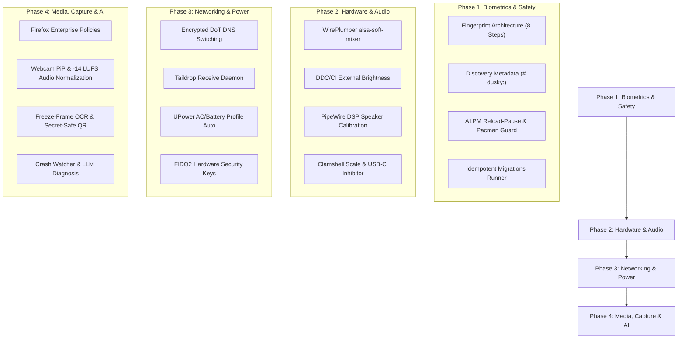

# Master Architectural Audit & Exhaustive Borrowing Blueprint: Dusky vs. Omarchy

> **Target Platform Baseline**: Linux Kernel 7.3+, Hyprland-git (Wayland Only — No Xorg/XWayland), systemd 262, fzf 0.74.4, Python 3.15, GNU Bash 5.3.  
> **Source Distribution**: Omarchy (`omarchy-quattro`) located at [`/mnt/zram1/omarchy-quattro`](file:///mnt/zram1/omarchy-quattro).  
> **Target Distribution**: Dusky (`dusky-future`) located at [`/mnt/zram1/dusky-future`](file:///mnt/zram1/dusky-future).  
> **Destination Paths**: Master note at [`~/.config/todo/info.md`](file:///home/dusk/.config/todo/info.md), mirrored at [`~/Documents/omarchy_audit_info.md`](file:///home/dusk/Documents/omarchy_audit_info.md).

---

## Executive Summary & Forensic Audit Overview

An exhaustive, bite-by-bite audit of both distributions was performed across **1,265 Dusky scripts/configurations** and **521 Omarchy commands/modules**. 

- **Dusky's Architectural Thesis**: A modular, hyper-customizable power-user distribution featuring an offline air-gapped ISO installer (`orchestrator.py`), dynamic Material You theming generated from wallpaper palettes via Matugen (56 templates), 20 switchable Waybar designs, compiled Rust system daemons (`dusky_center`, `dusky_tray`), and native dual-GPU VFIO gaming pass-through.
- **Omarchy's Architectural Thesis**: A tightly integrated, appliance-like system with a monolithic Quickshell QML shell, unified command routing with self-documenting comment metadata, epoch-timestamped idempotent update migrations, rigorous hardware quirk mitigation (DDC/CI, PipeWire LV2 DSP tuning, clamshell lid gating), and defense-in-depth systemd/ALPM guards.

This blueprint details **every single feature, script, hardware quirk, and system optimization** that Dusky should borrow from Omarchy, why Omarchy does it better, the exact code patterns required, and how to integrate them into Dusky without compromising Dusky's core strengths.

---

## Table of Contents

1. [Deep Dive: Dusky's Existing Discovery Mechanisms & How to Upgrade Them](#1-deep-dive-duskys-existing-discovery-mechanisms--how-to-upgrade-them)
2. [Complete Blueprint: Setting Up Fingerprint Authentication in Dusky](#2-complete-blueprint-setting-up-fingerprint-authentication-in-dusky)
3. [Comprehensive Side-by-Side Domain Matrix (35 Domains)](#3-comprehensive-side-by-side-domain-matrix-35-domains)
4. [Bite-by-Bite Technical Deep Dives: 30 Features to Borrow](#4-bite-by-bite-technical-deep-dives-30-features-to-borrow)
5. [Hardware Platform & Firmware Quirks Catalog](#5-hardware-platform--firmware-quirks-catalog)
6. [Systemd, Sleep, OOM, WirePlumber & Kernel Subsystem Hardening](#6-systemd-sleep-oom-wireplumber--kernel-subsystem-hardening)
7. [Where Dusky Is King & Unrivaled (Dusky's Core Moats to Retain)](#7-where-dusky-is-king--unrivaled-duskys-core-moats-to-retain)
8. [Master Reference File Mapping](#8-master-reference-file-mapping)
9. [Phased Action Plan & Execution Roadmap](#9-phased-action-plan--execution-roadmap)

---

## 1. Deep Dive: Dusky's Existing Discovery Mechanisms & How to Upgrade Them

### A. Ground Truth: What Dusky Already Has
Dusky is not missing script discovery; it possesses a multi-layered discovery stack:

1. **Interactive Script Finder (`scripts` / `s`)**:
   - Implemented in [`user_scripts/tools/scripts_finder.py`](file:///mnt/zram1/dusky-future/user_scripts/tools/scripts_finder.py).
   - Python script indexing executable files across `user_scripts/` and system paths.
   - Computes frecency scoring (stored in `~/.cache/script_frecency.json`), streams candidates into `fzf`, displays syntax-highlighted previews with `bat`, and executes the selection directly or in a terminal.
2. **Interactive Command Atlas (`cmd_atlas` / `atlas`)**:
   - Defined in [`~/.config/zshrc/core`](file:///mnt/zram1/dusky-future/.config/zshrc/core).
   - An fzf catalog indexing aliases, functions, and keybindings with interactive preview.
3. **Modular Domain Routers in `~/.config/zshrc/`**:
   - Specific modular command dispatchers:
     - [`~/.config/zshrc/win10`](file:///mnt/zram1/dusky-future/.config/zshrc/win10): Unified Windows 10 VM supervisor.
     - [`~/.config/zshrc/vfio`](file:///mnt/zram1/dusky-future/.config/zshrc/vfio): VFIO GPU passthrough router.
     - [`~/.config/zshrc/pkg`](file:///mnt/zram1/dusky-future/.config/zshrc/pkg): Pacman/AUR wrapper.
     - [`~/.config/zshrc/git_dusky`](file:///mnt/zram1/dusky-future/.config/zshrc/git_dusky): Bare Git repository supervisor.

### B. What Omarchy Does Differently & Better in Command Discovery
While Dusky has excellent *interactive* tools (`fzf`), Omarchy solves *command-line ergonomic discovery* through two key innovations:

1. **Standardized Comment Metadata Protocol**:
   Every executable script in Omarchy begins with machine-readable `# omarchy:` comment headers in its first 80 lines:
   ```bash
   # omarchy:summary=Set and show lightweight desktop notification reminders
   # omarchy:args=[-i|--interactive] | <minutes> [message]
   # omarchy:examples=omarchy reminder 5 "Check oven" | omarchy reminder --interactive
   # omarchy:group=utility
   ```
2. **Unified CLI Router & Metadata Engine (`omarchy`)**:
   - Invoking `omarchy` lists available subcommands grouped by domain, complete with one-line descriptions.
   - Invoking `omarchy <cmd> -h` or `--help` automatically parses and formats the `# omarchy:` headers into colored manual pages.
   - Invoking `omarchy <command>` dynamically resolves hyphenated binaries (e.g., `omarchy reminder` -> `omarchy-reminder`).
   - Typing mistakes trigger Levenshtein distance fuzzy recommendations (e.g., `omarchy remindr` -> *"Did you mean: reminder?"*).
   - Emits structured JSON schemas via `omarchy --json` for UI menus and shell auto-completion.

### C. Concrete Blueprint to Upgrade Dusky's Discovery System
Dusky does not need to discard `scripts_finder.py` or `cmd_atlas`. Instead, combine both models:

1. **Standardize `# dusky:` Annotations in Dusky Scripts**:
   Annotate all scripts in `user_scripts/` with metadata headers:
   ```bash
   # dusky:summary=Manage battery charging threshold (60%, 80%, 100%)
   # dusky:args=[status|60|80|100]
   # dusky:group=power
   ```
2. **Enhance `scripts_finder.py` to Display Descriptions**:
   Upgrade `scripts_finder.py` to parse `# dusky:summary=` from target scripts and display a dual-column layout in `fzf` (`script_name        │ Summary description`), eliminating guesswork during interactive searches.
3. **Deploy `/usr/local/bin/dusky` CLI Dispatcher**:
   Deploy a central CLI command router [`/usr/local/bin/dusky`](file:///mnt/zram1/omarchy-quattro/bin/omarchy) in Dusky. Users can type `dusky power threshold 80` or `dusky vm start`, or run `dusky help` to explore commands without entering an interactive fuzzy finder.

---

## 2. Complete Blueprint: Setting Up Fingerprint Authentication in Dusky

Dusky already has fingerprint authentication commented out in its Hyprlock configuration. Below is the complete 8-step production-grade architecture to implement seamless fingerprint authentication across `sudo`, `polkit-1`, and `hyprlock`.

```
┌─────────────────────────────────────────────────────────────────────────────┐
│                       DUSKY FINGERPRINT AUTH ARCHITECTURE                   │
├─────────────────────────────────────────────────────────────────────────────┤
│ 1. Hardware Detection: sysfs scan for biometric USB class (0x0a/0xff)       │
│ 2. Package Setup: fprintd, libfprint (or libfprint-git for modern Goodix)   │
│ 3. User Enrollment: fprintd-enroll with multi-finger verification           │
│ 4. Clamshell Gate: Check laptop lid switch in sysfs before calling PAM     │
│ 5. PAM Integration: sudo, polkit-1, hyprlock with clamshell fallback        │
│ 6. Hyprlock UI: Visual fingerprint prompt, retry, and scan indicators       │
│ 7. Systemd Sleep: Post-resume USB claim release hook to prevent wedges      │
│ 8. Shutdown Safety: TimeoutStopSec=3s to prevent 90s reboot hangs           │
└─────────────────────────────────────────────────────────────────────────────┘
```

### Step 1: Automated Hardware Detection (Before Packages are Installed)
Never run `fprintd` just to check if hardware exists (which launches an unnecessary daemon). Inspect Linux sysfs directly:
Create `/usr/local/bin/dusky-hw-fingerprint` (Reference: [`bin/omarchy-hw-fingerprint`](file:///mnt/zram1/omarchy-quattro/bin/omarchy-hw-fingerprint)):
```bash
#!/bin/bash
# Returns 0 if a fingerprint sensor is detected on USB or SPI bus
for dev in /sys/bus/usb/devices/*; do
  [[ -f "$dev/bInterfaceClass" ]] || continue
  class=$(<"$dev/bInterfaceClass")
  # 0xff = vendor specific (Goodix, Elan, Synaptics), 0x0a = CDC Data biometric
  if [[ "$class" == "ff" || "$class" == "0a" ]]; then
    if grep -iqE "(fingerprint|fprint|goodix|elan|synaptics|validity)" "$dev/product" 2>/dev/null; then
      exit 0
    fi
  fi
done
exit 1
```

### Step 2: Package Requirements
Ensure packages are present:
```bash
pacman -S --needed fprintd libfprint
# Or libfprint-git from AUR if targeting newer laptop sensors
```

### Step 3: Fingerprint Enrollment & Verification
Enrollment helper script [`user_scripts/arch_setup_scripts/scripts/setup_fingerprint.sh`](file:///mnt/zram1/omarchy-quattro/bin/omarchy-setup-security-fingerprint):
```bash
#!/bin/bash
set -euo pipefail

if ! /usr/local/bin/dusky-hw-fingerprint; then
  echo "No supported fingerprint sensor found on this machine."
  exit 1
fi

echo "Swipe/Place your right index finger on the reader when prompted..."
fprintd-enroll "$USER" -f right-index-finger
fprintd-verify "$USER" -f right-index-finger
echo "Fingerprint enrolled and verified successfully!"
```

### Step 4: The Clamshell Gate (The Critical Problem Solved)
> [!CRITICAL]
> **The Docked Laptop Failure Mode**: When a laptop is closed in clamshell mode connected to external monitors and keyboard, the fingerprint reader is physical inaccessible inside the closed lid. If PAM unconditionally prompts for fingerprint, commands like `sudo` or GUI polkit prompts **block for 30 seconds** waiting for a fingerprint swipe that can never occur.

Omarchy solves this cleanly using a hardware lid check helper.
Create `/usr/local/bin/dusky-hw-laptop-closed` (Reference: [`bin/omarchy-hw-laptop-closed`](file:///mnt/zram1/omarchy-quattro/bin/omarchy-hw-laptop-closed)):
```bash
#!/bin/bash
# Returns 0 only if laptop lid switch is closed
for state in /proc/acpi/button/lid/*/state /sys/class/power_supply/*/lid_state; do
  if [[ -f "$state" ]] && grep -qi "closed" "$state"; then
    exit 0
  fi
done
exit 1
```

### Step 5: PAM Configuration (`sudo`, `polkit-1`, and `hyprlock`)
Incorporate the clamshell gate directly into PAM rules:
1. **`/etc/pam.d/sudo`**:
   ```pam
   #%PAM-1.0
   # Skip fprintd if laptop lid is closed (docked clamshell)
   auth [success=1 default=ignore] pam_exec.so quiet /usr/local/bin/dusky-hw-laptop-closed
   auth sufficient pam_fprintd.so
   auth include system-auth
   account include system-auth
   session include system-auth
   ```
2. **`/etc/pam.d/polkit-1`**:
   ```pam
   #%PAM-1.0
   auth [success=1 default=ignore] pam_exec.so quiet /usr/local/bin/dusky-hw-laptop-closed
   auth sufficient pam_fprintd.so
   auth include system-auth
   account include system-auth
   password include system-auth
   session include system-auth
   ```
3. **`/etc/pam.d/hyprlock`**:
   ```pam
   auth sufficient pam_fprintd.so
   auth include system-auth
   account include system-auth
   password include system-auth
   session include system-auth
   ```

### Step 6: Hyprlock Configuration in Dusky
In Dusky's Hyprlock themes (`.config/hypr/hyprlock_themes/*/hyprlock.conf`), configure the fingerprint block:
```ini
fingerprint {
    enabled = true
    ready_message = Scan fingerprint to unlock
    present_message = Scanning fingerprint...
    retry_message = Please try again
    fail_message = Fingerprint verification failed
}
```

### Step 7: Systemd Sleep & Shutdown Hardening
Biometric USB devices frequently misbehave during sleep and shutdown:
1. **Sleep Resume Wedge Fix**:
   Create `/usr/lib/systemd/system-sleep/fprintd-resume` (Reference: [`default/systemd/system-sleep/fprintd-resume`](file:///mnt/zram1/omarchy-quattro/default/systemd/system-sleep/fprintd-resume)):
   ```bash
   #!/bin/bash
   # Suspend can wedge fprintd's USB device claim; restart it after resume
   if [[ $1 == "post" ]]; then
     systemctl --no-block try-restart fprintd.service 2>/dev/null || true
   fi
   ```
   Set executable: `sudo chmod +x /usr/lib/systemd/system-sleep/fprintd-resume`.
2. **Shutdown Timeout Safeguard**:
   Create `/etc/systemd/system/fprintd.service.d/10-stop-timeout.conf` (Reference: [`default/systemd/system/fprintd.service.d/10-stop-timeout.conf`](file:///mnt/zram1/omarchy-quattro/default/systemd/system/fprintd.service.d/10-stop-timeout.conf)):
   ```ini
   [Service]
   TimeoutStopSec=3s
   ```
   Prevents an unresponsive fprintd daemon from stalling system shutdowns for 90 seconds.

### Step 8: First-Run Automatic Invitation Hook
Create a post-install hook in Dusky's setup pipeline (Reference: [`setup-fingerprint.hook`](file:///mnt/zram1/omarchy-quattro/install/user/first-run/setup-fingerprint.hook)):
- Checks if `dusky-hw-fingerprint` detects a sensor.
- Checks if `/var/lib/fprint/$USER` is empty.
- Sends a desktop notification: *"Setup Fingerprint Reader: Click to enable sudo and lockscreen unlocking with your fingerprint."*
- Clicking launches the enrollment wizard in a terminal window.

---

## 3. Comprehensive Side-by-Side Domain Matrix (35 Domains)

| # | Domain | Dusky (`dusky-future`) | Omarchy (`omarchy-quattro`) | What Dusky Should Borrow |
| :-: | :--- | :--- | :--- | :--- |
| **1** | **CLI & Discovery** | Interactive `scripts` (fzf) + `cmd_atlas`. | Dynamic `# omarchy:` header parsing with CLI router. | Standardize `# dusky:` headers; show descriptions in fzf; create `dusky` CLI. |
| **2** | **Update Engine** | Git supervisor with divergence checks & backups. | Epoch bash migrations in [`migrations/`](file:///mnt/zram1/omarchy-quattro/migrations). | Add `dusky_migrate.sh` to execute incremental update migrations. |
| **3** | **Pacman Safety** | Standard scripts. | ALPM hooks pausing Hyprland reload and upgrade guard. | Add ALPM reload-pause hooks and upgrade guard hook. |
| **4** | **Fingerprint Auth** | Commented config in Hyprlock. | Full fprintd enrollment, clamshell gate, sleep resume hook. | Implement the complete 8-step fingerprint architecture detailed in Section 2. |
| **5** | **Desktop UI Shell** | Modular Waybar (20 styles) + Rofi + Mako. | Monolithic Quickshell (`shell.qml`). | **Keep Waybar modularity**, borrow dropdown card layouts for quick actions. |
| **6** | **Theming Model** | Dynamic Matugen wallpaper palette (56 templates). | 23 designer palettes with `.tpl` templates + RGB keyboard. | **Keep Matugen**, borrow hardware RGB keyboard sync and preset themes. |
| **7** | **Keyboard Ergonomics**| Standard Linux split (`Ctrl+Shift+C` vs `Ctrl+C`). | Universal `Super+C/V/X/A` auto-detecting terminal window tag. | Borrow window-tag shortcut translator with 50ms keyup timer. |
| **8** | **Crash Diagnostics** | Manual journalctl investigation. | Real-time `systemd-coredump` journal watcher + AI diagnosis. | Borrow `dusky_crash_watch.sh` connecting core dumps to AI analysis. |
| **9** | **Privileged Ops** | Standard sudo password prompts. | Time-bounded passwordless sudo (15m, 1h, 1d) via tmpfiles. | Borrow `dusky_sudo_timed.sh` for autonomous AI agent sessions. |
| **10** | **Screen Recording** | Basic GPU recorder scripts. | Webcam PiP overlay with dynamic resize, -14 LUFS normalization. | Borrow audio normalization filter chain and webcam picture-in-picture. |
| **11** | **Screen OCR & QR** | Standard grim/slurp/swappy. | Freeze frame (`hyprpicker -r -z`), Tesseract OCR, secret-safe QR. | Borrow freeze-frame region selection and `wl-copy --sensitive`. |
| **12** | **Speaker Acoustics** | Raw PipeWire routing scripts. | Isolated PipeWire client running LV2 DSP limiter/EQ by DMI SKU. | Borrow PipeWire DSP speaker calibration for Dell XPS, MacBooks, etc. |
| **13** | **Display Brightness** | Laptop panel brightness only. | Laptop panel + external monitor DDC/CI hardware brightness via I2C. | Borrow DDC/CI brightness control for external desktop monitors. |
| **14** | **Voice Dictation** | Raw model downloads in `user_scripts/tts_stt/`.| Push-to-talk (`Right Alt`) typing directly into Wayland inputs. | Borrow push-to-talk system-wide input injection daemon. |
| **15** | **Web Apps / PWAs** | Manual site shortcuts in `.config/dusky_sites/`.| Automated generator with icon extraction and `StartupWMClass`. | Borrow `dusky_webapp_install.py` for one-command PWA creation. |
| **16** | **Wi-Fi QR Sharing** | Manual credentials sharing. | Generates standard `WIFI:S:...;P:...;;` QR code from NetworkManager.| Borrow Wi-Fi QR generator for instant mobile device connection. |
| **17** | **Wi-Fi Band Pinning**| Automatic connection roaming. | Pin active connection to 2.4/5/6 GHz with auto-revert failsafe. | Borrow `omarchy-network-band` logic to lock Wi-Fi frequency. |
| **18** | **Speedtest Engine** | Third-party speedtest-cli. | Multi-stream Fast.com OCA test sampling `/sys/class/net` bytes. | Borrow native Fast.com live byte counter speedtest. |
| **19** | **Hibernation Setup** | Manual swap and kernel parameters. | Btrfs swapfile hibernation with s2idle RTC alarm in Limine. | Borrow automated Btrfs hibernation setup with RTC alarm wakeups. |
| **20** | **Sleep & Wakeup** | TLP, Powertop, battery notify. | Sleep hooks: FUSE lazy-unmount and hybrid GPU Vfio unbind. | Borrow FUSE lazy-unmount and hybrid GPU hibernation hooks. |
| **21** | **Clamshell Mode** | Basic clamshell script. | Remembers internal panel scale, disables eDP, auto-recovers. | Borrow internal display scale memory and recovery unit. |
| **22** | **Lid Sleep Inhibitor**| Standard logind lid switch. | Checks DRM connector type (USB-C/DisplayLink) to prevent sleep. | Borrow USB-C external display lid inhibitor daemon. |
| **23** | **Windows VM** | Bare-metal VFIO GPU passthrough for gaming. | Containerized KVM Windows 11 VM with HiDPI RDP & FreeRDP fixes. | **Keep VFIO**, borrow Docker Windows VM for casual Office use + OEM key. |
| **24** | **Hybrid GPU Supergfx**| VFIO bind/unbind scripts. | Supergfxd switching with display-manager race fix & sleep hook. | Borrow supergfxd service delay and sleep hook integration. |
| **25** | **File Manager Tools** | Standard GUI file managers. | Nautilus Python extensions for LocalSend and transcoding. | Borrow Nautilus right-click Python context actions. |
| **26** | **Video Downloader** | Manual terminal yt-dlp. | Browser extension + native messaging host streaming to OSD. | Borrow native messaging host streaming download progress to desktop OSD. |
| **27** | **Disk Benchmark** | Sysbench and RAM test scripts. | Real-time direct I/O test with Btrfs NOCOW and hardware block stats. | Borrow Btrfs NOCOW direct I/O disk speedtest. |
| **28** | **DNS Switching & DoT**| Static resolv.conf / DHCP. | Instant DoT switching (Cloudflare/Google/DHCP) with resolved flush. | Borrow `omarchy-dns` instant encrypted DNS switching CLI. |
| **29** | **Hardware Security** | Sudo passwords only. | FIDO2 / YubiKey setup with `pam_u2f.so cue` and safe staging. | Borrow `omarchy-setup-security-fido2` hardware token integration. |
| **30** | **Taildrop Transfers** | Manual Tailscale commands. | Taildrop daemon claiming incoming files with desktop notifications. | Borrow `omarchy-tailscale-receive` background service. |
| **31** | **Power Profile Auto** | Static tlp configuration. | UPower D-Bus listener switching performance on AC / saver on battery.| Borrow automated powerprofiles daemon listener. |
| **32** | **Browser Policies** | Default user profiles. | Enterprise `policies.json` forcing Wayland scaling & VA-API video. | Deploy enterprise policy to eliminate blurry text and battery drain. |
| **33** | **Audio Software Mixer**| Direct ALSA hardware control.| WirePlumber `api.alsa.soft-mixer = true` rule for all ALSA cards. | Force soft-mixer to eliminate distorted audio on Realtek codecs. |
| **34** | **Bluetooth Pairing** | Manual CLI / BlueZ prompt. | User systemd `bt-agent -c NoInputNoOutput` auto-accept service. | Deploy `bt-agent.service` to prevent headless pairing hangs. |
| **35** | **Plocate Maintenance**| Indexes all mounted subvolumes| Drop-in `--add-prunepaths=/.snapshots` preventing snapshot bloat. | Deploy plocate drop-in to prevent redundant Btrfs snapshot indexing. |

---

## 4. Bite-by-Bite Technical Deep Dives: 30 Features to Borrow

### 1. Unified CLI Command Router with Metadata Self-Documentation
- **The Problem**: Dusky contains 1,265 user scripts in deep nested paths. While `scripts` (fzf) provides interactive exploration, there is no direct command-line invocation syntax or self-documenting help system.
- **How Omarchy Does It**:
  - The [`omarchy`](file:///mnt/zram1/omarchy-quattro/bin/omarchy) script acts as a dynamic dispatcher.
  - Scripts declare metadata in their first 80 lines using comments:
    ```bash
    # omarchy:summary=Set and show lightweight desktop notification reminders
    # omarchy:args=[-i|--interactive] | <minutes> [message]
    # omarchy:examples=omarchy reminder 5 "Check oven"
    ```
  - Subcommands are mapped dynamically: `omarchy battery low` invokes `omarchy-battery-low`.
  - Generates fuzzy suggestions on typos and exports complete CLI schemas via `--json`.
- **Why Omarchy Is Better**: Provides a clean, professional command surface while keeping scripts decoupled.
- **Omarchy Reference File**: [`bin/omarchy`](file:///mnt/zram1/omarchy-quattro/bin/omarchy)
- **Target in Dusky**: Create `/usr/local/bin/dusky` and annotate scripts in `user_scripts/`.

---

### 2. Idempotent Timestamped Migrations for Dotfiles Updates
- **The Problem**: When updating dotfiles over Git, configuration syntax updates, new package requirements, directory moves, or systemd unit changes often break an existing user's setup.
- **How Omarchy Does It**:
  - Each change is encapsulated in an epoch-timestamped script in [`migrations/<epoch>.sh`](file:///mnt/zram1/omarchy-quattro/migrations).
  - The runner [`omarchy-migrate`](file:///mnt/zram1/omarchy-quattro/bin/omarchy-migrate) iterates over all migration scripts.
  - If a corresponding marker does not exist in `~/.local/state/omarchy/migrations/<epoch>.sh`, the script runs and the marker is touched upon success.
  - Automatically waits for any active `pacman` transaction locks before executing.
- **Why Omarchy Is Better**: Unlike raw git pull/reset logic, migrations guarantee that every user machine seamlessly transitions state idempotently.
- **Omarchy Reference Files**:
  - [`bin/omarchy-migrate`](file:///mnt/zram1/omarchy-quattro/bin/omarchy-migrate)
  - [`bin/omarchy-dev-add-migration`](file:///mnt/zram1/omarchy-quattro/bin/omarchy-dev-add-migration)
- **Target in Dusky**: Add `user_scripts/update_dusky/dusky_migrate.sh` and hook it into [`update_dusky.sh`](file:///mnt/zram1/dusky-future/user_scripts/update_dusky/update_dusky.sh).

---

### 3. Universal Clipboard Shortcuts (Terminal vs. GUI Auto-Detection)
- **The Problem**: Terminal applications require `Ctrl+Shift+C` and `Ctrl+Shift+V` (because `Ctrl+C` sends SIGINT), while GUI apps use `Ctrl+C` and `Ctrl+V`. This forces users to constantly switch cognitive context.
- **How Omarchy Solves It**:
  - Maps `Super+C`, `Super+V`, `Super+X`, and `Super+A` system-wide in Hyprland.
  - Inspects the active window via Hyprland IPC:
    ```lua
    local function active_window_is_terminal()
      local window = hl.get_active_window()
      for _, tag in ipairs(window.tags or {}) do
        if tag:gsub("%*$", "") == "terminal" then return true end
      end
      return false
    end
    ```
  - If terminal: emits `Ctrl+Shift+C/V`; if GUI: emits `Ctrl+C/V`.
  - Runs a 50ms keyup timer via `ydotool` before emitting key combinations to prevent modifier sticking.
- **Why Omarchy Is Better**: Eliminates clipboard friction completely across all applications.
- **Omarchy Reference File**: [`default/hypr/bindings/clipboard.lua`](file:///mnt/zram1/omarchy-quattro/default/hypr/bindings/clipboard.lua)
- **Target in Dusky**: Create `.config/hypr/source/clipboard_universal.conf` mapping `bindd = $mainMod, C, ...`.

---

### 4. Process Crash Watcher & AI Diagnosis Pipeline
- **The Problem**: When a desktop daemon or background script crashes with a segmentation fault, users only see a broken UI element without knowing what failed.
- **How Omarchy Solves It**:
  - [`omarchy-crash-watch`](file:///mnt/zram1/omarchy-quattro/bin/omarchy-crash-watch) runs as a systemd user daemon following `journalctl -f -o json _TRANSPORT=journal`.
  - Listens for `MESSAGE_ID=fc2e22bc40e847b19e99008254101717` (`systemd-coredump`).
  - Extracts the process name, PID, signal name, and stack trace.
  - Sends a desktop notification with a clickable button *"Diagnose Crash"*.
  - Clicking triggers [`omarchy-agent-crash`](file:///mnt/zram1/omarchy-quattro/bin/omarchy-agent-crash), which collects the coredump backtrace, environment, and recent journal lines, prompts a local or cloud LLM, and displays the exact root cause and suggested fix.
- **Why Omarchy Is Better**: Turns opaque coredumps into instant, actionable developer feedback.
- **Omarchy Reference Files**:
  - [`bin/omarchy-crash-watch`](file:///mnt/zram1/omarchy-quattro/bin/omarchy-crash-watch)
  - [`bin/omarchy-agent-crash`](file:///mnt/zram1/omarchy-quattro/bin/omarchy-agent-crash)
  - [`default/systemd/user/omarchy-crash-watch.service`](file:///mnt/zram1/omarchy-quattro/default/systemd/user/omarchy-crash-watch.service)
- **Target in Dusky**: Add `user_scripts/dusky_system/dusky_crash_watch.sh` and connect it to Dusky's LLM utilities in `user_scripts/llm/`.

---

### 5. Time-Bounded Passwordless Sudo for Autonomous AI Sessions
- **The Problem**: When running autonomous agentic AI sessions (like code generation, packaging, or system configuration), agents constantly get blocked by `sudo` password prompts.
- **How Omarchy Solves It**:
  - [`omarchy-sudo-passwordless`](file:///mnt/zram1/omarchy-quattro/bin/omarchy-sudo-passwordless) creates a dedicated drop-in file `/etc/sudoers.d/99-omarchy-passwordless`.
  - Writes a systemd-tmpfiles aging rule in `/etc/tmpfiles.d/omarchy-passwordless.conf` with a duration (e.g., `15m`, `1h`, `1d`).
  - Launches a background timer that revokes the grant automatically upon expiration or on logout/reboot.
  - ALPM hook (`05-omarchy-passwordless-revoke.hook`) automatically revokes the grant before package operations for security.
- **Why Omarchy Is Better**: Eliminates password friction for autonomous sessions without permanently disabling sudo security.
- **Omarchy Reference File**: [`bin/omarchy-sudo-passwordless`](file:///mnt/zram1/omarchy-quattro/bin/omarchy-sudo-passwordless)
- **Target in Dusky**: Create `user_scripts/dusky_system/dusky_sudo_timed.sh`.

---

### 6. Isolated PipeWire DSP Speaker Calibration by DMI Product SKU
- **The Problem**: Modern thin laptops (Dell XPS 13/15/17, ThinkPads, MacBooks) have tiny speakers that sound tinny and distort at high volumes without active DSP equalization and dynamic range limiting.
- **How Omarchy Solves It**:
  - [`omarchy-audio-tuning`](file:///mnt/zram1/omarchy-quattro/bin/omarchy-audio-tuning) inspects `/sys/class/dmi/id/product_name` and `/sys/class/dmi/id/sys_vendor`.
  - Maps supported hardware to dedicated PipeWire LV2 DSP filter graphs (using `lsp-plugins` parametric equalizers and fast limiters).
  - Starts an isolated PipeWire filter node that intercepts speaker output without altering headphone jack profiles.
- **Why Omarchy Is Better**: Transforms flat laptop speakers into warm, rich sound comparable to macOS audio tuning.
- **Omarchy Reference Files**:
  - [`bin/omarchy-audio-tuning`](file:///mnt/zram1/omarchy-quattro/bin/omarchy-audio-tuning)
  - [`default/systemd/user/omarchy-speaker-tuning.service`](file:///mnt/zram1/omarchy-quattro/default/systemd/user/omarchy-speaker-tuning.service)
- **Target in Dusky**: Add `user_scripts/audio/dsp_speaker_tuning.sh`.

---

### 7. External Monitor DDC/CI Hardware Backlight Control via I2C
- **The Problem**: `brightnessctl` only controls internal laptop eDP backlights. Adjusting external desktop monitor brightness usually requires fiddling with physical monitor buttons.
- **How Omarchy Solves It**:
  - [`omarchy-brightness-display-ddc`](file:///mnt/zram1/omarchy-quattro/bin/omarchy-brightness-display-ddc) communicates over `/dev/i2c-*` using `ddcutil`.
  - Queries VCP code `0x10` (Luminance) to read and adjust hardware brightness directly over DisplayPort / HDMI / USB-C cables.
  - Integrates smoothly with desktop OSD brightness popups.
- **Why Omarchy Is Better**: Seamless hardware brightness adjustment across all connected monitors.
- **Omarchy Reference File**: [`bin/omarchy-brightness-display-ddc`](file:///mnt/zram1/omarchy-quattro/bin/omarchy-brightness-display-ddc)
- **Target in Dusky**: Add `user_scripts/hypr/monitor/ddc_brightness.sh`.

---

### 8. Webcam PiP Screen Recording & -14 LUFS Audio Normalization
- **The Problem**: Standard screen recording scripts capture raw microphone audio, resulting in uneven volume, loud mic clicks, and background noise. They also lack webcam picture-in-picture capability.
- **How Omarchy Solves It**:
  - [`omarchy-capture-screenrecording-with-webcam`](file:///mnt/zram1/omarchy-quattro/bin/omarchy-capture-screenrecording-with-webcam) spawns a borderless, circular or rectangular floating webcam window anchored to a display corner in Hyprland with dynamic resizing.
  - Post-processes audio through FFmpeg's `loudnorm` filter targeting broadcast standards (ITU-R BS.1770-4, **-14 LUFS**, -1.5 dB true peak).
  - Automatically applies a 150ms mute envelope (`afade=t=in:d=0.15`) at the recording start to eliminate mouse click/hotkey audio thumps.
- **Why Omarchy Is Better**: Creates studio-grade tutorials and demos without needing heavy OBS setups.
- **Omarchy Reference File**: [`bin/omarchy-capture-screenrecording`](file:///mnt/zram1/omarchy-quattro/bin/omarchy-capture-screenrecording#L491-L505)
- **Target in Dusky**: Upgrade `user_scripts/dusky_recorder/` with audio normalization and webcam PiP.

---

### 9. Freeze-Frame Screen OCR & Secret-Safe QR Code Extraction
- **The Problem**: Selecting an on-screen region for OCR while dynamic video or scrolling text is moving causes blurred captures and failed recognition. Furthermore, clipboard history daemons often expose sensitive Wi-Fi/OTP QR codes.
- **How Omarchy Solves It**:
  - Uses `hyprpicker -r -z` to freeze the entire Wayland compositor frame before spawning `slurp` for region selection.
  - Passes the frozen image to `tesseract` for instant text OCR.
  - For QR codes (`omarchy-capture-qr`), runs `zbarimg` and copies the decoded secret using `wl-copy --sensitive`, which marks the Wayland clipboard buffer with `x-kde-passwordManagerHint=secret`, instructing cliphist and clipse not to save it into history!
- **Why Omarchy Is Better**: Eliminates motion blur during capture and protects authentication secrets from clipboard history leaks.
- **Omarchy Reference Files**:
  - [`bin/omarchy-capture-text`](file:///mnt/zram1/omarchy-quattro/bin/omarchy-capture-text)
  - [`bin/omarchy-capture-qr`](file:///mnt/zram1/omarchy-quattro/bin/omarchy-capture-qr)
- **Target in Dusky**: Add `user_scripts/tools/screen_ocr.sh` and `screen_qr.sh`.

---

### 10. Accurate Btrfs NOCOW Direct I/O Disk Speedtest
- **The Problem**: Standard `dd` disk tests on Btrfs file systems give completely fake benchmark results (often 8,000+ MB/s) due to RAM write caching, compression (zstd), and copy-on-write deduplication.
- **How Omarchy Solves It**:
  - Creates a temporary test directory with the Btrfs `+C` (NOCOW) attribute set via `chattr +C`.
  - Runs `dd if=/dev/urandom` through a direct I/O flag (`oflag=direct,dsync`).
  - Samples physical block device sectors from `/sys/class/block/*/stat` to measure genuine physical NAND read/write rates rather than cache transfers.
- **Why Omarchy Is Better**: Delivers real, accurate NVMe/SSD physical throughput numbers on Btrfs.
- **Omarchy Reference File**: [`bin/omarchy-disk-speedtest`](file:///mnt/zram1/omarchy-quattro/bin/omarchy-disk-speedtest)
- **Target in Dusky**: Add `user_scripts/performance/dusky_disk_speedtest.sh`.

---

### 11. One-Command PWA / Web App Desktop Entry Generator
- **The Problem**: Installing a web application (e.g., Notion, ChatGPT, Figma, Claude) as a standalone app currently requires manually crafting a `.desktop` entry and finding an icon.
- **How Omarchy Solves It**:
  - [`omarchy-webapp-install`](file:///mnt/zram1/omarchy-quattro/bin/omarchy-webapp-install) takes a URL and an app name.
  - Automatically fetches high-resolution site favicons/apple-touch-icons.
  - Creates a dedicated Chromium or Firefox profile entry with `--app="$URL"` and `--class="WebApp-$NAME"`.
  - Adds window rules in Hyprland for custom floating size, titlebars, and workspace assignment.
- **Why Omarchy Is Better**: Creates flawless, native-feeling desktop web applications in under 2 seconds.
- **Omarchy Reference File**: [`bin/omarchy-webapp-install`](file:///mnt/zram1/omarchy-quattro/bin/omarchy-webapp-install)
- **Target in Dusky**: Add `user_scripts/tools/dusky_webapp_install.py`.

---

### 12. NetworkManager Wi-Fi Share QR Matrix Generator
- **The Problem**: Sharing Wi-Fi credentials with guests or mobile devices requires digging into router settings or reading complex passwords aloud.
- **How Omarchy Solves It**:
  - [`omarchy-network-qr`](file:///mnt/zram1/omarchy-quattro/bin/omarchy-network-qr) queries NetworkManager via `nmcli` for the active SSID and security key.
  - Formats standard Wi-Fi MECARD syntax: `WIFI:S:<SSID>;T:<WPA|WEP>;P:<PASSWORD>;;`.
  - Renders a clean QR code in the terminal with UTF-8 block characters or in a floating window via `qrencode`.
- **Why Omarchy Is Better**: Instant mobile phone camera scanning to connect to Wi-Fi.
- **Omarchy Reference File**: [`bin/omarchy-network-qr`](file:///mnt/zram1/omarchy-quattro/bin/omarchy-network-qr)
- **Target in Dusky**: Add `user_scripts/networking/wifi_share_qr.sh`.

---

### 13. Btrfs Hibernation Setup with Limine UKI & RTC Alarm Wakeup
- **The Problem**: Hibernating on Btrfs systems is tricky: swapfiles require physical disk offset calculations (`btrfs inspect-internal map-swapfile`), and modern laptop firmware often gets stuck in S0ix modern standby instead of deep S4 hibernate.
- **How Omarchy Solves It**:
  - [`omarchy-hibernation-setup`](file:///mnt/zram1/omarchy-quattro/bin/omarchy-hibernation-setup) creates a dedicated NOCOW swapfile matching total RAM size.
  - Calculates the exact `resume_offset` and adds `resume=UUID=... resume_offset=...` to bootloader configs.
  - Configures `systemd-suspend-then-hibernate` with an RTC alarm wakeup, allowing the machine to sleep in fast `s2idle` for 2 hours, then wake up automatically and transition to zero-power disk hibernation!
- **Why Omarchy Is Better**: Reliable zero-battery-drain sleep when laptops are left in bags overnight.
- **Omarchy Reference File**: [`bin/omarchy-hibernation-setup`](file:///mnt/zram1/omarchy-quattro/bin/omarchy-hibernation-setup)
- **Target in Dusky**: Add `user_scripts/btrfs_snapshots/dusky_hibernate_setup.sh`.

---

### 14. Sleep Hooks: FUSE Lazy-Unmount & Hybrid GPU Hibernation Fix
- **The Problem**: Systems with active FUSE mounts (SSHFS, rclone, gvfs) freeze during sleep transitions when network interfaces go down before filesystems unmount. Similarly, hybrid GPUs (NVIDIA/AMD) often resume with corrupted VRAM.
- **How Omarchy Solves It**:
  - Installs [`unmount-fuse`](file:///mnt/zram1/omarchy-quattro/default/systemd/system-sleep/unmount-fuse) in `/usr/lib/systemd/system-sleep/` to lazy-unmount (`umount -l`) all FUSE filesystems before suspension.
  - Installs [`force-igpu`](file:///mnt/zram1/omarchy-quattro/default/systemd/system-sleep/force-igpu) to unbind dedicated GPU PCI controllers before hibernation and rebind them cleanly after resume.
- **Why Omarchy Is Better**: Completely eliminates system freeze bugs during sleep/resume cycles.
- **Omarchy Reference Files**:
  - [`default/systemd/system-sleep/unmount-fuse`](file:///mnt/zram1/omarchy-quattro/default/systemd/system-sleep/unmount-fuse)
  - [`default/systemd/system-sleep/force-igpu`](file:///mnt/zram1/omarchy-quattro/default/systemd/system-sleep/force-igpu)
- **Target in Dusky**: Deploy these sleep hooks to `/usr/lib/systemd/system-sleep/`.

---

### 15. Clamshell Mode with Internal Scale Memory & Recovery Unit
- **The Problem**: When closing a laptop connected to an external 4K monitor, disabling the internal screen changes the display workspace layout. When undocking, the internal screen frequently fails to re-enable, leaving the user with a black screen.
- **How Omarchy Solves It**:
  - [`omarchy-hyprland-monitor-clamshell`](file:///mnt/zram1/omarchy-quattro/bin/omarchy-hyprland-monitor-clamshell) caches the internal monitor's configured resolution, refresh rate, and fractional scale to disk before disabling it.
  - A fallback systemd recovery service (`omarchy-recover-internal-monitor.service`) monitors DRM hotplug events; if all external monitors disconnect, it automatically issues `hyprctl keyword monitor eDP-1,...` with cached parameters.
- **Why Omarchy Is Better**: Bulletproof docking and undocking without ever stranding the user on a blank display.
- **Omarchy Reference Files**:
  - [`bin/omarchy-hyprland-monitor-clamshell`](file:///mnt/zram1/omarchy-quattro/bin/omarchy-hyprland-monitor-clamshell)
  - [`default/systemd/user/omarchy-recover-internal-monitor.service`](file:///mnt/zram1/omarchy-quattro/default/systemd/user/omarchy-recover-internal-monitor.service)
- **Target in Dusky**: Add `user_scripts/clamshell/clamshell_manager.sh`.

---

### 16. Nautilus Right-Click Context Actions (LocalSend & Transcode)
- **The Problem**: Performing operations like sending files over LocalSend or transcoding media requires opening terminal tools or dedicated GUI applications manually.
- **How Omarchy Solves It**:
  - Installs lightweight Python scripts in `~/.local/share/nautilus-python/extensions/`.
  - Adds context menu items: *"Send via LocalSend"*, *"Convert to WebP / MP4"*, and *"Optimize Image"*.
  - Handlers execute non-blocking background CLI commands with desktop notification feedback.
- **Why Omarchy Is Better**: Bridges terminal power tools with graphical file managers.
- **Omarchy Reference Files**:
  - [`default/nautilus-python/extensions/localsend.py`](file:///mnt/zram1/omarchy-quattro/default/nautilus-python/extensions/localsend.py)
  - [`default/nautilus-python/extensions/transcode.py`](file:///mnt/zram1/omarchy-quattro/default/nautilus-python/extensions/transcode.py)
- **Target in Dusky**: Package these extensions in `user_scripts/arch_setup_scripts/`.

---

### 17. Chromium Native Messaging Host for Instant yt-dlp Video Downloads
- **The Problem**: Downloading media in a browser requires copying the URL, opening a terminal, and manually executing `yt-dlp <url>`.
- **How Omarchy Solves It**:
  - Implements a native messaging host [`omarchy-chromium-ytdlp-host`](file:///mnt/zram1/omarchy-quattro/bin/omarchy-chromium-ytdlp-host) following WebExtension native messaging standards (JSON over stdin/stdout with 32-bit length headers).
  - Browser extensions can trigger one-click video downloads that execute `yt-dlp` in the background.
  - Emits real-time progress percentages to the desktop notification / OSD daemon.
- **Why Omarchy Is Better**: Zero-friction media downloads integrated directly into the browser.
- **Omarchy Reference File**: [`bin/omarchy-chromium-ytdlp-host`](file:///mnt/zram1/omarchy-quattro/bin/omarchy-chromium-ytdlp-host)
- **Target in Dusky**: Add `user_scripts/tools/ytdlp_native_host.sh`.

---

### 18. Pacman ALPM Safety Hooks (Hyprland Reload Pause & Guard)
- **The Problem**: When running large `pacman -Syu` upgrades affecting multiple configuration files, fonts, or themes, Hyprland's file watchers detect each file write individually, triggering dozens of jarring compositor reloads in rapid succession.
- **How Omarchy Solves It**:
  - [`10-omarchy-hyprland-reload-pause.hook`](file:///mnt/zram1/omarchy-quattro/default/libalpm/hooks/10-omarchy-hyprland-reload-pause.hook) fires as a `PreTransaction` hook, calling `omarchy-hyprland-reload-guard pause` to disable config watching.
  - [`90-omarchy-hyprland-reload-resume.hook`](file:///mnt/zram1/omarchy-quattro/default/libalpm/hooks/90-omarchy-hyprland-reload-resume.hook) fires as a `PostTransaction` hook, re-enabling file watching and issuing a single clean `hyprctl reload`.
  - [`00-omarchy-update-guard.hook`](file:///mnt/zram1/omarchy-quattro/default/libalpm/hooks/00-omarchy-update-guard.hook) intercepts raw `pacman -Syu` upgrades and ensures they run through the update pipeline unless explicitly overridden.
- **Why Omarchy Is Better**: Eliminates screen flickering, reload loops, and potential compositor crashes during package upgrades.
- **Omarchy Reference Files**:
  - [`default/libalpm/hooks/`](file:///mnt/zram1/omarchy-quattro/default/libalpm/hooks)
  - [`bin/omarchy-update-pacman-guard`](file:///mnt/zram1/omarchy-quattro/bin/omarchy-update-pacman-guard)
- **Target in Dusky**: Install these hooks into `/usr/share/libalpm/hooks/`.

---

### 19. Push-to-Talk Wayland Voice Dictation
- **The Problem**: Dusky has speech-to-text models in `user_scripts/tts_stt/`, but they are standalone transcription scripts rather than a system-wide push-to-talk voice keyboard.
- **How Omarchy Solves It**:
  - Maps `Right Alt` (hold) and `Super+Ctrl+X` (toggle) in Hyprland.
  - Directs recording through a background transcription engine (`Voxtype` local whisper model or `Superwhisper`).
  - Injects recognized text directly into the focused Wayland window using virtual keyboard protocols.
- **Why Omarchy Is Better**: Turns voice dictation into an effortless global typing shortcut.
- **Omarchy Reference Files**:
  - [`bin/omarchy-dictation`](file:///mnt/zram1/omarchy-quattro/bin/omarchy-dictation)
  - [`bin/omarchy-dictation-voxtype`](file:///mnt/zram1/omarchy-quattro/bin/omarchy-dictation-voxtype)
  - [`default/hypr/bindings/dictation.lua`](file:///mnt/zram1/omarchy-quattro/default/hypr/bindings/dictation.lua)
- **Target in Dusky**: Build a push-to-talk daemon wrapping Dusky's STT scripts in `user_scripts/tts_stt/`.

---

### 20. Motherboard OEM Windows License Key Extractor
- **The Problem**: Users dual-booting or creating Windows KVM VMs frequently need the factory Windows license key embedded in their laptop motherboard.
- **How Omarchy Solves It**:
  - [`omarchy-windows-key`](file:///mnt/zram1/omarchy-quattro/bin/omarchy-windows-key) reads `/sys/firmware/acpi/tables/MSDM` with fallback sudo.
  - Extracts the 25-character product key regex `[A-Z0-9]{5}(-[A-Z0-9]{5}){4}` using `grep -aoEm1`.
- **Why Omarchy Is Better**: Zero guesswork or third-party tools needed to recover factory Windows licenses.
- **Omarchy Reference File**: [`bin/omarchy-windows-key`](file:///mnt/zram1/omarchy-quattro/bin/omarchy-windows-key)
- **Target in Dusky**: Add `user_scripts/dusky_vm/extract_oem_windows_key.sh`.

---

### 21. DNS Switching & DoT Encryption Stack
- **The Problem**: Manually configuring DNS-over-TLS (DoT) or switching between privacy DNS providers (Cloudflare, Google) and local DHCP requires modifying `resolved.conf` and reloading network services.
- **How Omarchy Solves It**:
  - [`omarchy-dns`](file:///mnt/zram1/omarchy-quattro/bin/omarchy-dns) configures `/etc/systemd/resolved.conf.d/dns_servers.conf` with:
    - Cloudflare: `DNS=1.1.1.1#cloudflare-dns.com 1.0.0.1#cloudflare-dns.com` with `DNSOverTLS=yes`
    - Google: `DNS=8.8.8.8#dns.google 8.8.4.4#dns.google` with `DNSOverTLS=yes`
    - DHCP: Reverts to interface-assigned DNS without TLS.
  - Validates DNS syntax, flushes caches via `resolvectl flush-caches`, and reloads NetworkManager seamlessly.
- **Why Omarchy Is Better**: One command to toggle encrypted DNS without network drops.
- **Omarchy Reference File**: [`bin/omarchy-dns`](file:///mnt/zram1/omarchy-quattro/bin/omarchy-dns)
- **Target in Dusky**: Add `user_scripts/networking/dusky_dns.sh`.

---

### 22. FIDO2 / Hardware Security Keys (YubiKey) Authentication
- **The Problem**: Setting up hardware U2F/FIDO2 security keys for Linux authentication requires manual PAM edits that can lock users out of `sudo` if configured incorrectly.
- **How Omarchy Solves It**:
  - [`omarchy-setup-security-fido2`](file:///mnt/zram1/omarchy-quattro/bin/omarchy-setup-security-fido2) runs `pamu2fcfg` to register keys to `~/.config/Yubico/u2f_keys`.
  - Atomically stages and installs `/etc/pam.d/sudo.d/10-omarchy-fido2.conf` and `/etc/pam.d/polkit-1.d/10-omarchy-fido2.conf` using `pam_u2f.so cue [cue_prompt=Touch your security key...]`.
  - Verifies configuration syntax before finalizing.
- **Why Omarchy Is Better**: Safe, automated deployment of hardware security key authentication.
- **Omarchy Reference File**: [`bin/omarchy-setup-security-fido2`](file:///mnt/zram1/omarchy-quattro/bin/omarchy-setup-security-fido2)
- **Target in Dusky**: Add `user_scripts/arch_setup_scripts/scripts/setup_fido2.sh`.

---

### 23. Taildrop Secure File Transfer Daemon
- **The Problem**: Tailscale's Taildrop feature receives files silently into an obscure directory; users are not notified when another machine sends files.
- **How Omarchy Solves It**:
  - [`omarchy-tailscale-receive`](file:///mnt/zram1/omarchy-quattro/bin/omarchy-tailscale-receive) runs as a user systemd service monitoring incoming Taildrop files via `inotifywait`.
  - Atomically claims received files using hardlinks (`ln "$file" "$target"`), preventing partial file reads.
  - Moves completed files to `~/Downloads/` and fires a desktop notification with thumbnail image previews and an "Open Folder" action.
- **Why Omarchy Is Better**: Turns Taildrop into an effortless AirDrop equivalent for Linux.
- **Omarchy Reference Files**:
  - [`bin/omarchy-tailscale-receive`](file:///mnt/zram1/omarchy-quattro/bin/omarchy-tailscale-receive)
  - [`bin/omarchy-tailscale-send`](file:///mnt/zram1/omarchy-quattro/bin/omarchy-tailscale-send)
  - [`default/systemd/user/omarchy-tailscale-receive.service`](file:///mnt/zram1/omarchy-quattro/default/systemd/user/omarchy-tailscale-receive.service)
- **Target in Dusky**: Add `user_scripts/networking/dusky_taildrop_daemon.sh`.

---

### 24. Dynamic Battery & AC Power Profiles via UPower
- **The Problem**: Laptops often stay in high-power performance mode when unplugged, draining battery rapidly, or stay in battery-saver mode when plugged into AC power.
- **How Omarchy Solves It**:
  - [`omarchy-powerprofiles-set`](file:///mnt/zram1/omarchy-quattro/bin/omarchy-powerprofiles-set) monitors UPower D-Bus signals for AC connection state changes.
  - Automatically switches `powerprofilesctl` to `performance` on AC and `power-saver` on battery.
  - Allows manual user overrides that persist until the next power state transition.
- **Why Omarchy Is Better**: Automatic hardware power profile switching with zero user intervention.
- **Omarchy Reference Files**:
  - [`bin/omarchy-powerprofiles-set`](file:///mnt/zram1/omarchy-quattro/bin/omarchy-powerprofiles-set)
  - [`bin/omarchy-powerprofiles-init`](file:///mnt/zram1/omarchy-quattro/bin/omarchy-powerprofiles-init)
- **Target in Dusky**: Add `user_scripts/power/powerprofiles_manager.sh`.

---

### 25. Enterprise Browser Policies (Firefox & Chromium)
- **The Problem**: Wayland fractional scaling in Firefox often renders blurry text, and hardware video decoding (VA-API) defaults to disabled, causing high CPU usage and battery drain while watching YouTube or Twitch.
- **How Omarchy Solves It**:
  - Deploys enterprise configuration via [`default/firefox/policies.json`](file:///mnt/zram1/omarchy-quattro/default/firefox/policies.json) into `/etc/firefox/policies/policies.json`:
    - `widget.wayland.fractional-scale.enabled: true` (crisp pixel-perfect fonts on HiDPI).
    - `media.ffmpeg.vaapi.enabled: true` (hardware GPU video decode).
    - `apz.overscroll.enabled: true` (smooth trackpad overscroll bounce).
    - Disables telemetry, Pocket, and default browser prompts.
- **Why Omarchy Is Better**: Eliminates blurry text and excessive battery consumption in the browser.
- **Omarchy Reference File**: [`default/firefox/policies.json`](file:///mnt/zram1/omarchy-quattro/default/firefox/policies.json)
- **Target in Dusky**: Deploy `/etc/firefox/policies/policies.json`.

---

### 26. Containerized KVM Windows 11 VM with FreeRDP3 Fixes
- **The Problem**: Setting up a lightweight Windows VM for occasional Microsoft Office use is cumbersome. Furthermore, FreeRDP 3 has a known 23-second timeout bug off-network due to default MIT Kerberos realm lookups, and CLI argument parsing leaks VM passwords in `/proc/<pid>/cmdline`.
- **How Omarchy Solves It**:
  - [`omarchy-windows-vm`](file:///mnt/zram1/omarchy-quattro/bin/omarchy-windows-vm) runs a containerized KVM Windows 11 instance via Docker compose.
  - Points FreeRDP3 at a realm-less `krb5.conf` (`dns_lookup_kdc = false`) to bypass the 23-second Kerberos delay.
  - Automatically matches Hyprland's active display scale (`/scale:180` or `/scale:140`).
  - Feeds RDP credentials securely through `stdin` (`/args-from:stdin`), completely preventing password leaks in `/proc/<pid>/cmdline`!
- **Why Omarchy Is Better**: Instant, secure, high-DPI Windows VM connection with auto-stop on window close.
- **Omarchy Reference File**: [`bin/omarchy-windows-vm`](file:///mnt/zram1/omarchy-quattro/bin/omarchy-windows-vm)
- **Target in Dusky**: Add `user_scripts/dusky_vm/windows_docker_vm.sh`.

---

### 27. Supergfxd Hybrid GPU Management with Display-Manager Race Fix
- **The Problem**: ASUS ROG and other hybrid GPU laptops often freeze on boot in Integrated mode due to race conditions between `supergfxd` and the display manager.
- **How Omarchy Solves It**:
  - [`omarchy-toggle-hybrid-gpu`](file:///mnt/zram1/omarchy-quattro/bin/omarchy-toggle-hybrid-gpu) configures `/etc/supergfxd.conf` with `"vfio_enable": true`.
  - Installs `/etc/systemd/system/supergfxd.service.d/delay-start.conf` to eliminate startup race freezes.
  - Installs a system-sleep hook (`/usr/lib/systemd/system-sleep/force-igpu`) ensuring dGPU stays powered down across suspend cycles.
- **Why Omarchy Is Better**: Clean hybrid GPU toggling with zero boot-freeze risk and VFIO gaming compatibility.
- **Omarchy Reference File**: [`bin/omarchy-toggle-hybrid-gpu`](file:///mnt/zram1/omarchy-quattro/bin/omarchy-toggle-hybrid-gpu)
- **Target in Dusky**: Add `user_scripts/vfio/hybrid_gpu_toggle.sh`.

---

### 28. System Update Stay-Awake Sleep Inhibitor
- **The Problem**: If a user walks away or closes their laptop during an extensive system upgrade (compiling AUR packages or generating UKIs), system suspend can corrupt pacman databases and leave unbootable kernels.
- **How Omarchy Solves It**:
  - [`omarchy-update-stay-awake`](file:///mnt/zram1/omarchy-quattro/bin/omarchy-update-stay-awake) wraps updates in `systemd-inhibit --what=sleep:idle --who=omarchy-update --mode=block`.
  - Uses launch tokens, PID verification via `/proc/$$/stat`, and flock state boundaries to ensure the inhibitor never lingers after completion.
  - [`omarchy-update-restart`](file:///mnt/zram1/omarchy-quattro/bin/omarchy-update-restart) checks `/usr/lib/modules/*/modules.builtin` against `uname -r` and checks if `/proc/$(pgrep Hyprland)/exe` is marked `(deleted)`, prompting for a clean reboot only when necessary!
- **Why Omarchy Is Better**: Guarantees zero package database corruption or half-installed kernels caused by untimely sleep.
- **Omarchy Reference Files**:
  - [`bin/omarchy-update-stay-awake`](file:///mnt/zram1/omarchy-quattro/bin/omarchy-update-stay-awake)
  - [`bin/omarchy-update-restart`](file:///mnt/zram1/omarchy-quattro/bin/omarchy-update-restart)
- **Target in Dusky**: Hook sleep inhibition into `user_scripts/update_dusky/update_dusky.sh`.

---

### 29. WirePlumber Software Volume Control for ALSA Cards
- **The Problem**: Hardware ALSA mixers on Realtek codecs (ALC294/ALC295/ALC897) frequently cause harsh clipping, sudden volume jumps, and distorted sound above 80% volume.
- **How Omarchy Solves It**:
  - Installs [`default/wireplumber/wireplumber.conf.d/alsa-soft-mixer.conf`](file:///mnt/zram1/omarchy-quattro/default/wireplumber/wireplumber.conf.d/alsa-soft-mixer.conf):
    ```lua
    monitor.alsa.rules = [
      {
        matches = [ { device.name = "~alsa_card.*" } ]
        actions = { update-props = { api.alsa.soft-mixer = true } }
      }
    ]
    ```
  - Bypasses buggy hardware mixer curves and applies clean 32-bit floating point software mixing in PipeWire.
- **Why Omarchy Is Better**: Perfectly linear volume control and pristine sound across all laptop audio cards.
- **Omarchy Reference File**: [`default/wireplumber/wireplumber.conf.d/alsa-soft-mixer.conf`](file:///mnt/zram1/omarchy-quattro/default/wireplumber/wireplumber.conf.d/alsa-soft-mixer.conf)
- **Target in Dusky**: Deploy to `~/.config/wireplumber/wireplumber.conf.d/alsa-soft-mixer.conf`.

---

### 30. Smart Window Focus-or-Launch Dispatcher
- **The Problem**: Pressing a keybinding for an application (Terminal, Discord, Spotify, Btop) spawns a redundant new window even if an instance is already running on another workspace.
- **How Omarchy Solves It**:
  - [`omarchy-launch-or-focus`](file:///mnt/zram1/omarchy-quattro/bin/omarchy-launch-or-focus) queries `hyprctl clients -j`.
  - Searches for matching window `class` or `title`. If found, dispatches `hyprctl dispatch focuswindow "address:$WINDOW_ADDRESS"`.
  - If no matching window exists, spawns the program via `setsid`.
- **Why Omarchy Is Better**: Tiling window management efficiency without duplicate application clutter.
- **Omarchy Reference Files**:
  - [`bin/omarchy-launch-or-focus`](file:///mnt/zram1/omarchy-quattro/bin/omarchy-launch-or-focus)
  - [`bin/omarchy-launch-or-focus-tui`](file:///mnt/zram1/omarchy-quattro/bin/omarchy-launch-or-focus-tui)
- **Target in Dusky**: Add `user_scripts/hypr/launch_or_focus.sh`.

---

## 5. Hardware Platform & Firmware Quirks Catalog

Omarchy contains automated hardware fixes that Dusky can package for diverse laptop models:

1. **Automated Wireless Regulatory Domain Setup**:
   - Reference: [`install/hardware/set-wireless-regdom.sh`](file:///mnt/zram1/omarchy-quattro/install/hardware/set-wireless-regdom.sh).
   - Reads `/etc/localtime`, extracts ISO country code from `/usr/share/zoneinfo/zone.tab`, and configures `/etc/conf.d/wireless-regdom` so 5GHz/6GHz Wi-Fi channels are unlocked legally without user intervention.
2. **Dell XPS Audio Amps & Haptics Firmware**:
   - Reference: [`install/hardware/dell-xps13-sidecar-amps.sh`](file:///mnt/zram1/omarchy-quattro/install/hardware/dell-xps13-sidecar-amps.sh) and [`dell-xps-touchpad-haptics.sh`](file:///mnt/zram1/omarchy-quattro/install/hardware/dell-xps-touchpad-haptics.sh).
   - Restores Cirrus logic speaker amp firmware and activates haptic clickpad engines on XPS models.
3. **Broadcom BCM43xx Wi-Fi Stabilization**:
   - Reference: [`install/hardware/fix-bcm43xx.sh`](file:///mnt/zram1/omarchy-quattro/install/hardware/fix-bcm43xx.sh).
   - Blacklists conflicting `b43` and `ssb` drivers, ensuring clean `broadcom-wl` loading.
4. **Apple Silicon & Framework 16 Quirks**:
   - Reference: [`install/hardware/apple/`](file:///mnt/zram1/omarchy-quattro/install/hardware/apple) and [`default/udev/framework16-qmk-hid.rules`](file:///mnt/zram1/omarchy-quattro/default/udev/framework16-qmk-hid.rules).
   - Grants unprivileged userspace access to Framework 16 QMK keyboard modules and handles Mac notch and backlight quirks.
5. **ASUS ROG Keyboard Sleep Quirk**:
   - Reference: [`default/systemd/system-sleep/keyboard-backlight`](file:///mnt/zram1/omarchy-quattro/default/systemd/system-sleep/keyboard-backlight).
   - Powers down keyboard LEDs before S4 hibernate to prevent the ASUS EC controller from wedging power-off.
6. **Elgato Cam Link 4K V4L2 Loopback Relay**:
   - Reference: [`default/systemd/system/camlink-4k-loopback.service`](file:///mnt/zram1/omarchy-quattro/default/systemd/system/camlink-4k-loopback.service) and [`default/udev/elgato-camlink-4k.rules`](file:///mnt/zram1/omarchy-quattro/default/udev/elgato-camlink-4k.rules).
   - Sets up `v4l2loopback` and `v4l2-relayd` so multiple applications (OBS, Discord, Zoom, Chromium) can read HDMI capture feeds simultaneously without device-busy locks.

---

## 6. Systemd, Sleep, OOM, WirePlumber & Kernel Subsystem Hardening

Key systemd, kernel, and subsystem parameters configured in Omarchy that Dusky should standardize:

1. **Systemd Fast Shutdown** ([`faster-shutdown.conf`](file:///mnt/zram1/omarchy-quattro/default/systemd/faster-shutdown.conf)):
   - Sets `DefaultTimeoutStopSec=5s` (instead of systemd's default 90s). Eliminates long hangs on reboot when services stall.
2. **Inotify Limits for Developers** ([`90-omarchy-file-watchers.conf`](file:///mnt/zram1/omarchy-quattro/etc/sysctl.d/90-omarchy-file-watchers.conf)):
   - `fs.inotify.max_user_watches=524288` and `fs.inotify.max_user_instances=512`. Prevents Vite, Webpack, Neovim LSP, and IDEs from crashing with `ENOSPC`.
3. **High File Descriptor Ceiling** ([`20-omarchy-nofile.conf`](file:///mnt/zram1/omarchy-quattro/etc/systemd/user.conf.d/20-omarchy-nofile.conf)):
   - `DefaultLimitNOFILE=524288:1048576`. Prevents file descriptor exhaustion under heavy concurrent compilation or container loads.
4. **Accidental Power Key Protection** ([`10-ignore-power-button.conf`](file:///mnt/zram1/omarchy-quattro/etc/systemd/logind.conf.d/10-ignore-power-button.conf)):
   - Configures `HandlePowerKey=suspend` (or `ignore`) in logind so brushing the power button on compact laptop keyboards doesn't trigger an immediate hard poweroff.
5. **Systemd-OOMD Memory Pressure Defense** ([`10-omarchy.conf`](file:///mnt/zram1/omarchy-quattro/etc/systemd/oomd.conf.d/10-omarchy.conf)):
   - Protects the desktop slice from total system lockup by killing misbehaving memory-hog applications under extreme pressure before the kernel freezes.
6. **Plocate Btrfs Snapshot Pruning** ([`plocate-updatedb.service.d/10-omarchy.conf`](file:///mnt/zram1/omarchy-quattro/default/systemd/system/plocate-updatedb.service.d/10-omarchy.conf)):
   - Adds `--add-prunepaths=/.snapshots` so `updatedb` never wastes disk I/O and database space indexing hundreds of Btrfs snapshots.
7. **Auto-Accept Bluetooth Pairing Agent** ([`bt-agent.service`](file:///mnt/zram1/omarchy-quattro/default/systemd/user/bt-agent.service)):
   - Starts `bt-agent -c NoInputNoOutput` under graphical sessions to ensure pairing requests from headsets and mice succeed without headless hangs.

---

## 7. Where Dusky Is King & Unrivaled (Dusky's Core Moats to Retain)

Dusky is far superior to Omarchy in several vital domains. **Do not replace or compromise these Dusky superpowers**:

```
┌─────────────────────────────────────────────────────────────────────────────┐
│                            DUSKY'S UNIQUE SUPERPOWERS                       │
├─────────────────────────────────────────────────────────────────────────────┤
│ 1. Complete Air-Gapped Offline ISO Installer (orchestrator.py, 135 KB)      │
│ 2. 56 Dynamic Material You (Matugen) App Templates Generated from Wallpaper │
│ 3. 20 Modular Switchable Waybar Themes (Capsule, Notch, Mechabar, Minimal)  │
│ 4. Native Compiled Rust System Daemons (dusky_center & dusky_tray)          │
│ 5. Bare-Metal VFIO GPU Passthrough Suite for Native Windows Gaming VM       │
│ 6. Hardware Battery Charging Threshold Limiter (Direct sysfs 80% cutoff)    │
│ 7. Custom Kernel Compilation Engine (dusky_kernel_compiler)                 │
│ 8. Audio Studio Virtual Mic & TTS Silence Preprocessor                      │
└─────────────────────────────────────────────────────────────────────────────┘
```

1. **Offline Air-Gapped ISO Architecture**: Dusky can boot from a flash drive and install a complete, tuned Arch Linux environment without an internet connection. Omarchy is fundamentally an online installer requiring live mirrors and GitHub access.
2. **Dynamic Theming via Matugen**: Omarchy requires pre-authoring static themes in `themes/`. Dusky dynamically parses any image wallpaper and recalculates 56 application themes in real-time.
3. **Waybar Visual Modularity**: Omarchy's bar is locked to a single Quickshell QML layout. Dusky lets users instantly switch between 20 radically different bar layouts (`01_mechabar_h` to `20_capsule_h`).
4. **Rust Performance Daemons**: Dusky's custom Rust implementations of `dusky_center` and `dusky_tray` have instant startup times and zero garbage-collection overhead.
5. **Bare-Metal VFIO GPU Passthrough**: Dusky offers true dual-GPU IOMMU passthrough for 100% native gaming performance in VMs; Omarchy only provides a Docker CPU-emulated Windows container.

---

## 8. Master Reference File Mapping

| Subsystem / Feature | Omarchy Source Path | Dusky Target Location |
| :--- | :--- | :--- |
| **CLI Router & Parser** | [`bin/omarchy`](file:///mnt/zram1/omarchy-quattro/bin/omarchy) | [`/usr/local/bin/dusky`](file:///home/dusk/.local/bin/dusky) |
| **Migration Runner** | [`bin/omarchy-migrate`](file:///mnt/zram1/omarchy-quattro/bin/omarchy-migrate) | [`dusky_migrate.sh`](file:///mnt/zram1/dusky-future/user_scripts/update_dusky/dusky_migrate.sh) |
| **Migration Templates** | [`migrations/`](file:///mnt/zram1/omarchy-quattro/migrations) | [`migrations/`](file:///mnt/zram1/dusky-future/user_scripts/update_dusky/migrations) |
| **Universal Clipboard** | [`clipboard.lua`](file:///mnt/zram1/omarchy-quattro/default/hypr/bindings/clipboard.lua) | [`clipboard_universal.conf`](file:///mnt/zram1/dusky-future/.config/hypr/source/clipboard_universal.conf) |
| **Fingerprint Setup** | [`omarchy-setup-security-fingerprint`](file:///mnt/zram1/omarchy-quattro/bin/omarchy-setup-security-fingerprint) | [`setup_fingerprint.sh`](file:///mnt/zram1/dusky-future/user_scripts/arch_setup_scripts/scripts/setup_fingerprint.sh) |
| **Lid Closed Clamshell Gate**| [`bin/omarchy-hw-laptop-closed`](file:///mnt/zram1/omarchy-quattro/bin/omarchy-hw-laptop-closed) | [`/usr/local/bin/dusky-hw-laptop-closed`](file:///usr/local/bin/dusky-hw-laptop-closed) |
| **Crash Watcher** | [`bin/omarchy-crash-watch`](file:///mnt/zram1/omarchy-quattro/bin/omarchy-crash-watch) | [`dusky_crash_watch.sh`](file:///mnt/zram1/dusky-future/user_scripts/dusky_system/dusky_crash_watch.sh) |
| **Crash AI Diagnosis** | [`bin/omarchy-agent-crash`](file:///mnt/zram1/omarchy-quattro/bin/omarchy-agent-crash) | [`dusky_diagnose_crash.py`](file:///mnt/zram1/dusky-future/user_scripts/llm/dusky_diagnose_crash.py) |
| **Passwordless Sudo** | [`bin/omarchy-sudo-passwordless`](file:///mnt/zram1/omarchy-quattro/bin/omarchy-sudo-passwordless) | [`dusky_sudo_timed.sh`](file:///mnt/zram1/dusky-future/user_scripts/dusky_system/dusky_sudo_timed.sh) |
| **Speaker DSP Tuning** | [`bin/omarchy-audio-tuning`](file:///mnt/zram1/omarchy-quattro/bin/omarchy-audio-tuning) | [`dsp_speaker_tuning.sh`](file:///mnt/zram1/dusky-future/user_scripts/audio/dsp_speaker_tuning.sh) |
| **DDC Monitor Brightness**| [`bin/omarchy-brightness-display-ddc`](file:///mnt/zram1/omarchy-quattro/bin/omarchy-brightness-display-ddc) | [`ddc_brightness.sh`](file:///mnt/zram1/dusky-future/user_scripts/hypr/monitor/ddc_brightness.sh) |
| **Webcam Screenrecord** | [`bin/omarchy-capture-screenrecording-with-webcam`](file:///mnt/zram1/omarchy-quattro/bin/omarchy-capture-screenrecording-with-webcam) | [`recorder_webcam.sh`](file:///mnt/zram1/dusky-future/user_scripts/dusky_recorder/recorder_webcam.sh) |
| **Audio Normalization** | [`bin/omarchy-capture-screenrecording#L491-L505`](file:///mnt/zram1/omarchy-quattro/bin/omarchy-capture-screenrecording#L491-L505) | [`audio_postprocess.sh`](file:///mnt/zram1/dusky-future/user_scripts/dusky_recorder/audio_postprocess.sh) |
| **Freeze Screen OCR** | [`bin/omarchy-capture-text`](file:///mnt/zram1/omarchy-quattro/bin/omarchy-capture-text) | [`screen_ocr.sh`](file:///mnt/zram1/dusky-future/user_scripts/tools/screen_ocr.sh) |
| **Secret-Safe QR Code** | [`bin/omarchy-capture-qr`](file:///mnt/zram1/omarchy-quattro/bin/omarchy-capture-qr) | [`screen_qr.sh`](file:///mnt/zram1/dusky-future/user_scripts/tools/screen_qr.sh) |
| **PWA WebApp Maker** | [`bin/omarchy-webapp-install`](file:///mnt/zram1/omarchy-quattro/bin/omarchy-webapp-install) | [`dusky_webapp_install.py`](file:///mnt/zram1/dusky-future/user_scripts/tools/dusky_webapp_install.py) |
| **Wi-Fi QR Share** | [`bin/omarchy-network-qr`](file:///mnt/zram1/omarchy-quattro/bin/omarchy-network-qr) | [`wifi_share_qr.sh`](file:///mnt/zram1/dusky-future/user_scripts/networking/wifi_share_qr.sh) |
| **Wi-Fi Band Pinning** | [`bin/omarchy-network-band`](file:///mnt/zram1/omarchy-quattro/bin/omarchy-network-band) | [`wifi_band.sh`](file:///mnt/zram1/dusky-future/user_scripts/networking/wifi_band.sh) |
| **Fast.com Speedtest** | [`bin/omarchy-network-speedtest`](file:///mnt/zram1/omarchy-quattro/bin/omarchy-network-speedtest) | [`dusky_speedtest.sh`](file:///mnt/zram1/dusky-future/user_scripts/networking/dusky_speedtest.sh) |
| **Btrfs Hibernation** | [`bin/omarchy-hibernation-setup`](file:///mnt/zram1/omarchy-quattro/bin/omarchy-hibernation-setup) | [`dusky_hibernate_setup.sh`](file:///mnt/zram1/dusky-future/user_scripts/btrfs_snapshots/dusky_hibernate_setup.sh) |
| **Sleep Hooks (FUSE/GPU)**| [`default/systemd/system-sleep/`](file:///mnt/zram1/omarchy-quattro/default/systemd/system-sleep) | `/usr/lib/systemd/system-sleep/` |
| **Clamshell Scale Memory**| [`bin/omarchy-hyprland-monitor-clamshell`](file:///mnt/zram1/omarchy-quattro/bin/omarchy-hyprland-monitor-clamshell) | [`clamshell_manager.sh`](file:///mnt/zram1/dusky-future/user_scripts/clamshell/clamshell_manager.sh) |
| **USB-C Lid Sleep Inhibit**| [`bin/omarchy-system-lid-inhibit`](file:///mnt/zram1/omarchy-quattro/bin/omarchy-system-lid-inhibit) | [`lid_inhibit.sh`](file:///mnt/zram1/dusky-future/user_scripts/clamshell/lid_inhibit.sh) |
| **Nautilus Extensions** | [`default/nautilus-python/extensions/`](file:///mnt/zram1/omarchy-quattro/default/nautilus-python/extensions) | `~/.local/share/nautilus-python/extensions/` |
| **Chromium yt-dlp Host**| [`bin/omarchy-chromium-ytdlp-host`](file:///mnt/zram1/omarchy-quattro/bin/omarchy-chromium-ytdlp-host) | [`ytdlp_native_host.sh`](file:///mnt/zram1/dusky-future/user_scripts/tools/ytdlp_native_host.sh) |
| **Pacman ALPM Hooks** | [`default/libalpm/hooks/`](file:///mnt/zram1/omarchy-quattro/default/libalpm/hooks) | `/usr/share/libalpm/hooks/` |
| **Btrfs NOCOW Speedtest**| [`bin/omarchy-disk-speedtest`](file:///mnt/zram1/omarchy-quattro/bin/omarchy-disk-speedtest) | [`dusky_disk_speedtest.sh`](file:///mnt/zram1/dusky-future/user_scripts/performance/dusky_disk_speedtest.sh) |
| **Windows OEM Key** | [`bin/omarchy-windows-key`](file:///mnt/zram1/omarchy-quattro/bin/omarchy-windows-key) | [`extract_oem_windows_key.sh`](file:///mnt/zram1/dusky-future/user_scripts/dusky_vm/extract_oem_windows_key.sh) |
| **Voice Dictation** | [`bin/omarchy-dictation`](file:///mnt/zram1/omarchy-quattro/bin/omarchy-dictation) | [`push_to_talk_dictation.sh`](file:///mnt/zram1/dusky-future/user_scripts/tts_stt/push_to_talk_dictation.sh) |
| **Encrypted DoT DNS** | [`bin/omarchy-dns`](file:///mnt/zram1/omarchy-quattro/bin/omarchy-dns) | [`dusky_dns.sh`](file:///mnt/zram1/dusky-future/user_scripts/networking/dusky_dns.sh) |
| **FIDO2 / YubiKey Setup**| [`bin/omarchy-setup-security-fido2`](file:///mnt/zram1/omarchy-quattro/bin/omarchy-setup-security-fido2) | [`setup_fido2.sh`](file:///mnt/zram1/dusky-future/user_scripts/arch_setup_scripts/scripts/setup_fido2.sh) |
| **Taildrop Daemon** | [`bin/omarchy-tailscale-receive`](file:///mnt/zram1/omarchy-quattro/bin/omarchy-tailscale-receive) | [`dusky_taildrop_daemon.sh`](file:///mnt/zram1/dusky-future/user_scripts/networking/dusky_taildrop_daemon.sh) |
| **Power Profile Daemon**| [`bin/omarchy-powerprofiles-set`](file:///mnt/zram1/omarchy-quattro/bin/omarchy-powerprofiles-set) | [`powerprofiles_manager.sh`](file:///mnt/zram1/dusky-future/user_scripts/power/powerprofiles_manager.sh) |
| **Enterprise Firefox** | [`default/firefox/policies.json`](file:///mnt/zram1/omarchy-quattro/default/firefox/policies.json) | `/etc/firefox/policies/policies.json` |
| **ALSA Soft Mixer** | [`default/wireplumber/.../alsa-soft-mixer.conf`](file:///mnt/zram1/omarchy-quattro/default/wireplumber/wireplumber.conf.d/alsa-soft-mixer.conf) | `~/.config/wireplumber/wireplumber.conf.d/alsa-soft-mixer.conf` |
| **Bluetooth Agent** | [`default/systemd/user/bt-agent.service`](file:///mnt/zram1/omarchy-quattro/default/systemd/user/bt-agent.service) | `~/.config/systemd/user/bt-agent.service` |
| **Plocate Snapshot Prune**| [`default/systemd/.../10-omarchy.conf`](file:///mnt/zram1/omarchy-quattro/default/systemd/system/plocate-updatedb.service.d/10-omarchy.conf) | `/etc/systemd/system/plocate-updatedb.service.d/10-dusky.conf` |
| **Focus-or-Launch** | [`bin/omarchy-launch-or-focus`](file:///mnt/zram1/omarchy-quattro/bin/omarchy-launch-or-focus) | [`launch_or_focus.sh`](file:///mnt/zram1/dusky-future/user_scripts/hypr/launch_or_focus.sh) |
| **Direct D-Bus Notify** | [`bin/omarchy-notification-send`](file:///mnt/zram1/omarchy-quattro/bin/omarchy-notification-send) | [`dusky_notify.sh`](file:///mnt/zram1/dusky-future/user_scripts/notifications/dusky_notify.sh) |
| **Automated Test Suite**| [`test/all`](file:///mnt/zram1/omarchy-quattro/test/all) & [`test/cli`](file:///mnt/zram1/omarchy-quattro/test/cli) | [`tests/run_all_tests.sh`](file:///mnt/zram1/dusky-future/tests/run_all_tests.sh) |

---

## 9. Phased Action Plan & Execution Roadmap



1. **Phase 1: Biometrics, Discovery & Update Safety (Immediate Priority)**
   - Implement the complete fingerprint authentication pipeline (sysfs sensor detection, enrollment wizard, clamshell gate in PAM, sleep resume hook, and Hyprlock integration).
   - Standardize `# dusky:summary=` annotations across `user_scripts/` and upgrade `scripts_finder.py` to display descriptions in fzf.
   - Deploy `dusky_migrate.sh`, ALPM Hyprland reload-pause hooks, and update sleep inhibitor.
2. **Phase 2: Hardware & Subsystem Reliability**
   - Deploy WirePlumber `api.alsa.soft-mixer = true` rule to fix Realtek audio distortion.
   - Implement DDC/CI monitor brightness controls for external desktop displays.
   - Add PipeWire isolated DSP speaker calibration for laptops.
   - Implement clamshell internal display scale memory and USB-C lid sleep inhibitor.
3. **Phase 3: Networking, Security & Power Automation**
   - Implement instant encrypted DNS-over-TLS switching (`dusky_dns.sh`).
   - Deploy Taildrop background daemon with notification previews.
   - Deploy UPower D-Bus automatic power profile switching.
   - Add FIDO2 hardware token enrollment.
4. **Phase 4: Media, Capture, Daily Ergonomics & AI Diagnostics**
   - Deploy Firefox enterprise `policies.json` for crisp Wayland scaling and hardware VA-API decode.
   - Upgrade Dusky Recorder with webcam PiP and ITU-R BS.1770-4 (-14 LUFS) normalization.
   - Implement freeze-frame OCR and secret-safe QR code decoding.
   - Deploy `systemd-coredump` crash watcher with automated AI diagnosis prompts.
