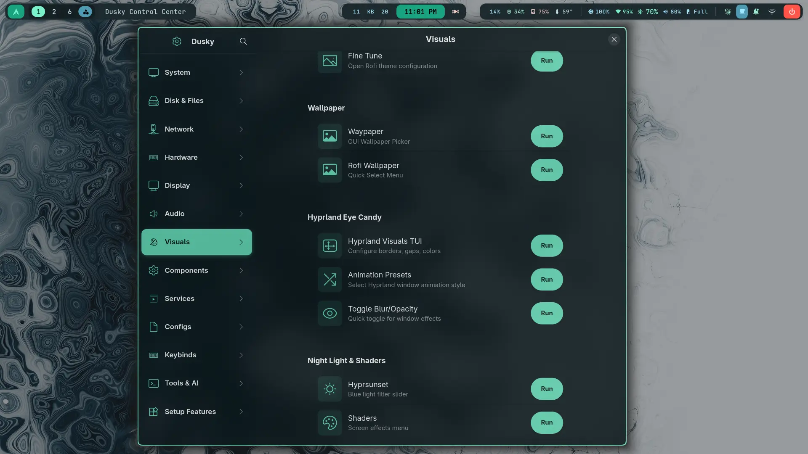

<div align="center">

# DUSKY

**The most performent while using the least amount of ram, like it should have always been**

[**Watch the Full System Walkthrough**](https://youtu.be/JmgvSdEIK8c) • [**Download Offline ISO (3.5 GB)**](https://drive.google.com/drive/folders/1P368khN1p-IfzWoaDnPyQNEcpkKBsOte?usp=sharing) • [**1,050+ Wallpapers**](https://github.com/dusklinux/images) • [**Community Discord**](https://discord.gg/gmyAxpAQYK)

*(Note: I’m not involved with the community-run Discord server—the best place to reach me is through the Issues section of this repo.)*

</div>

---

## Why Dusky Exists

Unfortunately, Linux is heading in the exact same direction as Windows, and I wanted something that used the absolute *least* amount of resources possible. It is easy to bloat an operating system, dress up heavy background services as "must have features," and ship them to everyone. It takes thousands of hours of obsessive engineering to make sure not a single background process uses a megabyte more than it strictly has to.

The honest truth is that the majority of bundled features in modern distros are never touched by the vast majority of users. They just sit there, eating resources and taking control out of your hands because a distro maintainer assumed they knew better than you. An OS shouldn't gobble up GIGABYTES of your RAM at idle or burn CPU cycles on mystery tasks in the background particularly when you dont need them.

At the same time, there is a fine line between minimalism and misery.

I used to think a minimal Arch Linux ISO with a few applications on top was all you needed for a proper setup. I was wrong. Over the last year, I learned the hard way that system configuration has no bottom. A stock minimal install might boot, but under the hood it is completely unconfigured..just waiting for you to hit a wall. You shouldn't have to spend hours debugging low level plumbing, and you shouldn't have to wonder why a background daemon is eating your RAM. That burden belongs on the developer, not the user.

Finding that exact balance is what I have spent the last year obsessing over. Across more than **7,000 commits** and thousands of iterations, I studied what other distributions and projects did well, borrowed their best ideas, stripped away their overhead, and rebuilt them to be faster and cleaner.

---

## How It Works Under the Hood

### 22 Megabytes of Instructions—Nothing Installed at Root
Dusky has more built-in capabilities than almost any distribution out there, yet none of them weigh down your system. Why? Because **they aren't "installed."**

Almost Everything lives inside a **~22 MB 'user_scripts' folder** in your user directory containing thousands of modular scripts. A script is nothing more than a sequence of instructions waiting for your computer to run it. Until you actually call a feature, it uses **zero** RAM and **zero** CPU. Nothing is permanently wired into your operating system at the root level. If you delete that one folder, all of it is gone.

### dusky TUI
I didn't want myself, or anyone else, to have to dig through raw config files every time a setting needed changing. At the same time, I refused to build a bloated GUI with a mountain of heavy dependencies when every Linux system already has a terminal.

And this is where I created a TUI Engine, this engine allows you to attach ALL files/configs to it and it opens those configs in a user friendly manner for you to easily change settings without knowing how to configure any linux config with unfamiliar syntax. You launch the TUI for what you want to tweak. Most importantly, every TUI runs on the **exact same shared engine**. Nothing is copied, nothing is repetitive, and the entire engine sits right inside that same user directory as a set of scripts!

### Rust vs. Quickshell
I made a deliberate, stubborn decision: **nothing in Dusky stays resident in RAM if it doesn't have to.** While Quickshell is easy to configure and write new UIs for, it is unacceptability ram hungry! Omarchy, for example uses 2 GB of RAM with *nothing* open and at that point you might as well use a stripped down windows iso.

I’ve written **EVERYTHING** in **Rust**. And since Rust is such a fast language, it doesn’t need a background service constantly running just to keep libraries loaded in memory for fast invocation. Instead, its **cold start beats Quickshell even when Quickshell has a background service running!**

* **Our dusky center(Settings App), dusky tray (quick panel), dusky paper (wallpaper switcher)** among other things are all written in Rust.
* **The dusky center** simply organizes all of dusky's underlying **700+ scripts** into an intuitive visual interface for times when you don't want to browse scripts manually.
* **FZF-based TUI Clipboard** with image preview support, optional vim keys navigation, and syntax highlighting for supported text.

We do not play around here. Every megabyte of baseline RAM we save is another megabyte you can put toward the heavy workloads you actually care about.



### The 5-Step Custom Kernel Compiler
Normally, compiling the Linux kernel takes three to four hours because mainline kernels pack tens of thousands of drivers for hardware you will never own. Those unused drivers sit on your disk and take up memory because traditional distributions have to mass-distribute one generic kernel for everyone. Because Dusky only compiles what your hardware actually needs, **it takes only 13 minutes on my 12th-gen laptop CPU, and 51 minutes on a 4th-gen i5 mobile CPU to compile a custom kernel!**

For the first time in any setup like this, Dusky includes a **5-step Kernel Compiler script** that builds a kernel tailored strictly to your machine. I took the best parts from CachyOS, Zen, and TKG, and added a *lot* more low-level performance kernel tuning above and beyond what anyone else does—with a **70/30 ratio** of optimizations baked directly into the kernel vs. runtime tweaks applied after the fact.

Two notable highlights:
* **Hardware Pruning:** Automatically strips out every driver your specific hardware doesn't need, shrinking the kernel size by **up to 90%** and cutting measurable baseline RAM usage by **50 MB**.
* **Native CPU Flags:** Compiles locally on your machine to match **YOUR** processor's exact instruction set, delivering a **minimum 7% performance uplift across the board** and **up to 25% higher performance** in specialized workloads (the benefit of not doing a one-size-fits-all kernel).

---

## A Personal Note on Sustainability

The reality of building on Arch Linux is that rolling releases break things constantly. Every now and then, an upstream update changes compositor syntax, or a package like the wallpaper daemon renames its binary overnight, forcing me to rewrite dozens of configs and scripts from scratch. Keeping a system this tightly integrated takes an enormous amount of patience and energy.

Right now, this is not an economically viable path. I haven't made a single cent off of Dusky, and **I refuse to ever monetize it or lock it behind a paywall.** It will remain completely free forever.

It can feel discouraging watching a handful of heavily marketed Linux projects pull in tens of millions of dollars in funding while independent developers burn out in a winner-takes-all ecosystem. Still, I want to keep doing this for as long as I can, because I know there are people who care about real craftsmanship. Our computers are deeply personal tools we use for hours every day—we shouldn't have to compromise on excellence or settle for bloatware.

All I ask is that you **speak with your time**:
* **Use software that respects your hardware** instead of settling for bloat.
* **Star this repository** and **open an issue** whenever an upstream update breaks something so I can fix it and keep making Dusky better.
* **If you are able, consider donating.**

---

## What's Inside the Box

Even with an idle footprint of roughly **~700 MB of RAM** and **~9 GB of disk space**, Dusky packs an enormous toolkit ready to run on demand:

### System, Storage & Hardware
* **TUIs for Everything (Around 50 TUIs!):** Edit Hyprland appearance (gaps, shadows, blur, opacity), configure `hypridle`, or remap shortcuts with a conflict-checking Keybind TUI that automatically unbinds collisions in `keybind.conf`.
* **Under-the-Hood Defaults:** Pre-configured BTRFS + ZSTD compression, ZRAM (tripling effective memory on low-spec machines), firewall, PAM, sudoers, and CPU-native AUR compilation flags.
* **Live Disk I/O Monitor:** Watch real-time read/write speeds so you know when USB or external drive transfers have genuinely finished flushing to disk.
* **BTRFS Compression Scanner:** Calculates exactly how much disk space ZSTD compression is saving across your OS.
* **Bare-Repo GitHub Backup:** Back up and sync your tracked dotfiles (configured via `~/.git_dusky_list`) directly to your own GitHub repository.
* **Maintenance & Power:** One-command cache purging, customizable laptop battery notifications, toggleable power-saver mode, and a `sysbench` benchmarking script.

### AI, Audio & Media
* **Offline Speech-to-Text & Text-to-Speech:** Local STT powered by **Parakeet** (CUDA / CPU) and local TTS powered by **Kokoro** (CPU / NVIDIA CUDA / AMD ROCm).
* **Circle to Search & Music Lookup:** On-screen Google Lens visual search and instant audio recognition for whatever is playing.
* **Two-Way Noise Cancellation:** Built-in bidirectional noise cancellation through **Dusky Audio Studio**.
* **Smart Audio Controls:** Single-keybind switching between outputs (e.g., jump from Bluetooth headphones to speakers without disconnecting), mono/stereo toggling, optional mechanical keypress sounds, and USB plug/unplug audio cues.

### Networking & Connectivity
* **One-Command Server Setups:** Automated scripts for **Tailscale**, **OpenSSH** (standalone or over Tailscale), and local **FTP servers**.
* **Cloudflare WARP:** Auto-setup and instant toggling directly from Rofi.
* **Wired & Wireless VNC:** Pre-built setup for low-latency remote screen control.
* **Wireless Tools:** Terminal Wi-Fi connection tool (`nmcli_wifi.sh`) and an `airmon` auditing script (strictly for testing access points you own).

### Desktop Workflow, Graphics & Gaming
* **Dynamic System Theming:** `Matugen` powers unified Light and Dark color schemes across the entire desktop—including Firefox/Gecko website theming via **Dusky Sites**.
* **Tuned Physics & Instant Shaders:** Days of fine-tuning went into the window momentum and animations for a liquid feel, alongside instant visual shader switching from Rofi.
* **Display & Controls:** Dynamic fractional scaling via keybind, scale-aware `wlogout` rendering, single-keybind blur/transparency/shadow toggles, and pop-up GUI sliders for Volume, Brightness, and Nightlight (`hyprsunset`).
* **Touchpad Gestures:** Laptop touchpad gestures for volume, brightness, screen locking, media play/pause, muting, and opening the notification center.
* **Gaming & Android:** Zero-latency GPU passthrough guide (Looking Glass for dual-GPU setups) and an automated **Waydroid** installer script.
* **Rofi Applets:** Emoji picker, Calculator, Matugen theme switcher, Animation switcher, Power menu, Clipboard manager, Wallpaper selector, Shader menu, and System menu.

---

## Prerequisites & Hardware

1. **Filesystem:** Strictly optimized for **BTRFS** (required for ZSTD compression, Copy-on-Write protection against data corruption, and instant snapshots; `ext4` works but is not recommended).
2. **Dual Booting & Bootloader:** Works cleanly alongside Windows or other Linux distros. Defaults to `systemd-boot` on UEFI (boots up to 5 seconds faster and light weight) and `GRUB` on BIOS.
3. **GPU Environment Variables (Intel / NVIDIA / AMD):** Hardware is auto-detected during setup. If you ever need to set GPU variables manually, edit `~/.config/uwsm/env` and `~/.config/uwsm/env-hyprland`.

---

## Installation

[**Watch the Installation Tutorial Video**](https://youtu.be/OzeFAY_8T8Y)

### Option 1: Dusky Offline ISO
If you want a ready-to-go offline installer without setting up base Arch first:
* [**Download the Dusky Offline ISO (Google Drive)**](https://drive.google.com/drive/folders/1P368khN1p-IfzWoaDnPyQNEcpkKBsOte?usp=sharing)

### Option 2: Fresh Arch + Hyprland Install
Best if you already have a fresh, unconfigured Arch Linux (or Arch-based distro like CachyOS) install with **BTRFS** and **Hyprland** selected via `archinstall` or manual setup.

#### Step 1: Clone Dotfiles (Bare Repo Method)
Dusky uses a bare Git repository to place files directly where they belong in `$HOME`.

Make sure you are connected to the internet and `git` is installed:
```bash
sudo pacman -Syu --needed git
```

Clone the repository and deploy the files:
```bash
git clone --bare --depth 1 https://github.com/dusklinux/dusky.git $HOME/dusky
git --git-dir=$HOME/dusky/ --work-tree=$HOME checkout -f
```
> **Note:** You will briefly see a few errors at the top of the screen right after checkout. Don't worry—this is normal and disappears automatically once `matugen` generates your colors and sets a wallpaper.

#### Step 2: Run the Orchestra
Run the master setup script to configure system services and install packages:
```bash
~/user_scripts/arch_setup_scripts/orchestrator.sh
```
* **How it works:** `orchestrator.sh` coordinates roughly 80 modular subscripts. It detects already-installed packages, skips them automatically, and is completely safe to re-run as many times as you like.
* **Time:** Expect **30 to 60 minutes** as `paru` compiles several packages from source. Stay near your machine to answer occasional `yes/no` prompts.

---

## Usage & Troubleshooting

### Keybinds Cheatsheet
Press `CTRL + SHIFT + SPACE` (or `CTRL + SHIFT + ?`) at any time to pull up the interactive Keybinds Cheatsheet. You can even click commands inside the menu to run them directly.

### If a Script Fails
Because Arch is a rolling release, an upstream package change can occasionally trip up a script:
1. **Don't panic.** The setup is completely modular—one failed subscript won't break the rest of the installation.
2. **Check the terminal output** to see which subscript in `~/user_scripts/arch_setup_scripts/scripts/` failed, and try running it individually.
3. **Check the Obsidian Vault or Open an Issue:** Browse the included ~2 MB Obsidian documentation notes in the repo, or open a ticket on GitHub and let me know so I can fix it.

---

## Acknowledgments

* [**hyprmoncfg**](https://github.com/crmne/hyprmoncfg) — For doing the heavy lifting behind the TUI monitor configuration.
* [**Omarchy**](https://github.com/basecamp/omarchy) — Our audio source switcher, network TUI, AI crash report generator, and fingerprint setup were partly borrowed from them with further tweaks and optimizations.
* [**linux-cachyos**](https://github.com/dusklinux/linux-cachyos) & [**linux-tkg**](https://github.com/Frogging-Family/linux-tkg) — For inspiring the Dusky Kernel.
* [**skwd-wall**](https://github.com/liixini/skwd-wall) — For inspiring the Rust-based Dusky Paper.
* [**Looking Glass**](https://github.com/gnif/LookingGlass) — For the low-latency Windows GPU passthrough setup.
* [**Matugen**](https://github.com/InioX/matugen) — For enabling system-wide dynamic theming across everything.
* [**Waybar**](https://github.com/Alexays/Waybar) — For allowing to choose from a wide range of configurable taskbar.
* [**TLP**](https://github.com/linrunner/TLP) — For allowing extensive configurability for power management.
* [**Mako**](https://github.com/emersion/mako) — This isn’t just a notification daemon; it is far beyond that and one of the most impressive projects out there.
* [**MatugenFox**](https://github.com/Ubaidullah-Web-Dev/MatugenFox) & [**refox**](https://github.com/ADIOR-enigma/refox) — For inspiring Dusky Sites, which makes dynamic website theming on Firefox/Gecko browsers possible.
* [**SilentSDDM**](https://github.com/uiriansan/SilentSDDM/) — Our optional SDDM greeter is a fork of this project.
* [**Papirus Icon Theme**](https://github.com/PapirusDevelopmentTeam/papirus-icon-theme) — The icon pack Dusky uses.
* [**mpv**](https://github.com/mpv-player/mpv) — The media player Dusky uses.
* [**Neovim**](https://github.com/neovim/neovim) — The terminal text editor.
* [**Yazi**](https://github.com/sxyazi/yazi) — The terminal file manager.
* [**Firefox**](https://github.com/mozilla-firefox/firefox) — Our default browser. Big thanks to them for keeping Manifest V2 supported even when incentivized not to.
* [**Foot**](https://github.com/yonasBSD/foot) & [**Kitty**](https://github.com/kovidgoyal/kitty) — For enabling a great terminal experience.
* [**Zsh**](https://github.com/zsh-users/zsh) — For being better than Bash while retaining compatibility with Bash.
* **All Contributors** — Thank you to everyone who has tested, submitted bug reports, shared suggestions, opened pull requests, or spread the word about Dusky. Thank you!
